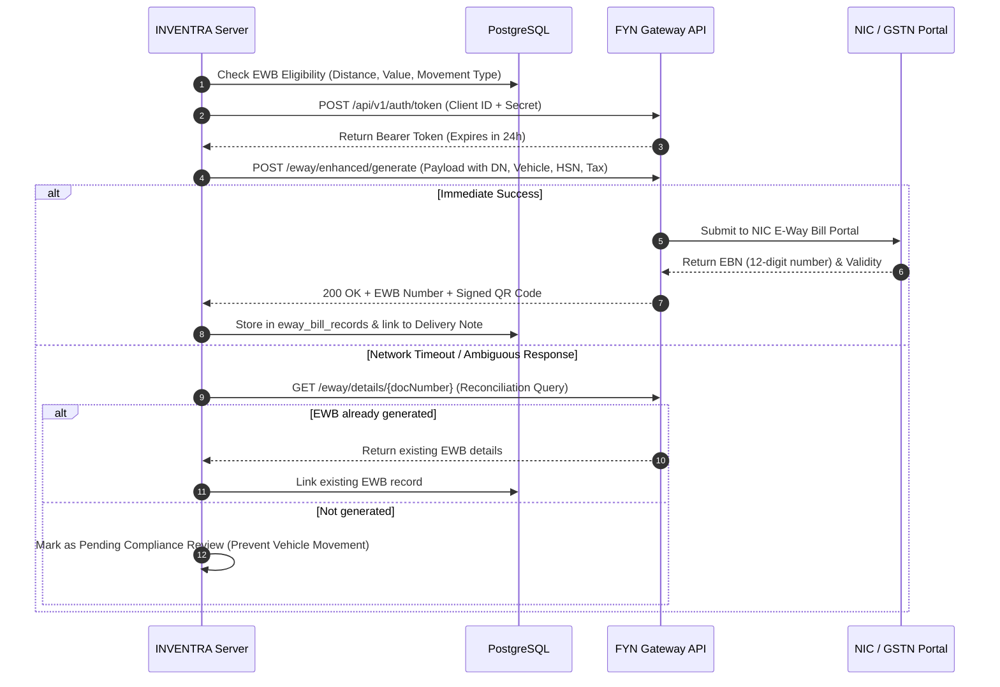
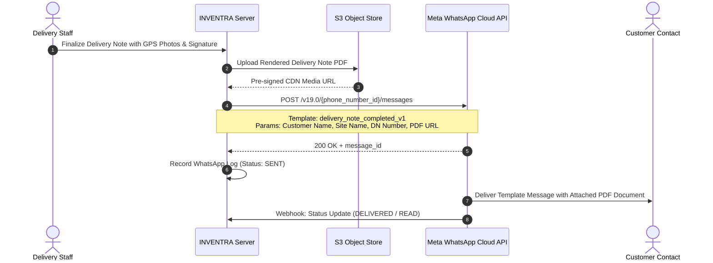

# INVENTRA – API Standards & External Integration Contracts

**Document Version**: 1.0  
**Operating Business**: AJAY ENTERPRISES  
**Software Brand**: INVENTRA  
**API Architectural Style**: RESTful JSON over HTTPS / Type-Safe Next.js Route Handlers  
**Reference Document**: Master Blueprint v1.0 (`docs/references/INVENTRA_Master_Software_Blueprint_v1.0.pdf`)

---

## 1. RESTful API Design Principles

All internal and external API endpoints in INVENTRA must adhere to strict, predictable RESTful conventions:

1. **Resource-Oriented URLs**: Use plural nouns for resources (e.g., `/api/v1/customers`, `/api/v1/delivery-notes`, `/api/v1/invoices`).
2. **Explicit HTTP Verbs**:
   - `GET`: Retrieve single or paginated resources. Read-only; strictly no side effects.
   - `POST`: Create a new resource or execute a domain action (e.g., `/api/v1/delivery-notes/:id/confirm-dispatch`).
   - `PUT`: Complete idempotent replacement of an existing resource.
   - `PATCH`: Partial update of allowed mutable fields.
   - `DELETE`: Soft delete or deactivate a resource.
3. **API Versioning**: All endpoints are prefixed with `/api/v1/`. Breaking changes require a new version path (`/api/v2/`).

---

## 2. Standardized JSON Request & Response Envelopes

Every API response returns a uniform JSON envelope structure, ensuring predictable parsing by frontend components and mobile PWA sync workers.

### 2.1 Standard Success Envelope
```json
{
  "success": true,
  "data": {
    "id": "018e47f2-1a2b-7c3d-8e4f-5a6b7c8d9e0f",
    "dnNumber": "DN-2026-0042",
    "status": "DELIVERED",
    "siteName": "Prestige Sunrise Tower B",
    "deliveredLinesCount": 4
  },
  "meta": {
    "page": 1,
    "limit": 25,
    "totalRecords": 1,
    "requestId": "req_018e47f2-99aa"
  },
  "timestamp": "2026-11-12T16:00:00.000Z"
}
```

### 2.2 Standard Error Envelope
```json
{
  "success": false,
  "error": {
    "code": "VALIDATION_FAILED",
    "message": "The submission failed validation checks.",
    "details": [
      {
        "field": "gstin",
        "message": "Invalid GSTIN format for Karnataka. State code must match '29'."
      },
      {
        "field": "lines.0.quantity",
        "message": "Dispatched quantity cannot exceed available warehouse stock (Available: 45)."
      }
    ],
    "requestId": "req_018e47f2-99aa"
  },
  "timestamp": "2026-11-12T16:00:00.000Z"
}
```

### 2.3 Standard HTTP Status Codes
- `200 OK`: Request succeeded.
- `201 Created`: Resource successfully created.
- `400 Bad Request`: Malformed JSON or syntax error.
- `401 Unauthorized`: Missing, expired, or invalid authentication session.
- `403 Forbidden`: Authenticated user lacks permission or record scope.
- `404 Not Found`: Target resource does not exist.
- `409 Conflict`: Concurrency conflict, duplicate document number, or overlapping billing interval.
- `422 Unprocessable Entity`: Zod business validation failure.
- `500 Internal Server Error`: Unhandled server exception (logged to audit trail with stack trace).

### 2.4 Supabase Authentication & Storage API Contracts

1. **Authentication Endpoints (`/api/v1/auth/`)**:
   - `POST /api/v1/auth/setup`: Bootstraps primary Owner (`USR-0001`) via Supabase Auth admin API and initializes baseline company profile, fiscal year, and document series. Permanently sealed with HTTP 403 once an owner exists.
   - `POST /api/v1/auth/login`: Authenticates email/username and password via Supabase Auth SSR, establishes secure session cookies, updates `lastLogin`, and verifies active status.
   - `POST /api/v1/auth/logout`: Terminates Supabase Auth session, clears cookies, and logs audit event.
   - `GET /api/v1/auth/me`: Returns active session user profile joined with allowed module actions.
   - `POST /api/v1/auth/change-password`: Verifies current credentials and rotates password in Supabase Auth.
   - `POST /api/v1/auth/forgot-password`: Dispatches password recovery email via Supabase Auth.
   - `POST /api/v1/auth/reset-password`: Completes recovery password reset via Supabase Auth recovery token.

2. **Private Storage Endpoints (`/api/v1/storage/`)**:
   - `POST /api/v1/storage/upload`: Server-authorized upload to private Supabase Storage bucket (`inventra-private-documents`). Enforces MIME whitelisting, 10MB file limit, and calculates SHA-256 checksums.
   - `GET /api/v1/storage/download?path={storagePath}&redirect={bool}`: Validates caller session and streams file with `Cache-Control: private` or redirects to a short-lived signed download URL (300s TTL).

---

## 3. Strict Input Validation Standards (Zod)

All incoming payloads are strictly validated on the server using **Zod** schemas. Validation happens before any business logic or database queries execute.

### 3.1 Central Statutory & Format Validators
```typescript
import { z } from 'zod';

// Indian Statutory & Financial Format Validators
export const IndianMobileSchema = z.string().regex(/^[6-9]\d{9}$/, {
  message: "Invalid mobile number. Must be a valid 10-digit Indian mobile starting with 6-9."
});

export const IndianPANSchema = z.string().regex(/^[A-Z]{5}[0-9]{4}[A-Z]{1}$/, {
  message: "Invalid PAN format. Must match 5 letters, 4 numbers, 1 letter (e.g. ABCDE1234F)."
});

export const IndianGSTINSchema = z.string().regex(/^[0-9]{2}[A-Z]{5}[0-9]{4}[A-Z]{1}[1-9A-Z]{1}Z[0-9A-Z]{1}$/, {
  message: "Invalid GSTIN format. Must be 15 alphanumeric characters conforming to GST rules."
});

export const IndianPinCodeSchema = z.string().regex(/^[1-9][0-9]{5}$/, {
  message: "Invalid Indian Postal PIN code. Must be a 6-digit number not starting with 0."
});

export const MonetaryAmountSchema = z.number().positive().finite().refine(
  (val) => Number(val.toFixed(2)) === val,
  { message: "Amount must have at most 2 decimal places (paise)." }
);

export const MaterialQuantitySchema = z.number().positive().finite().refine(
  (val) => Number(val.toFixed(3)) === val,
  { message: "Quantity must have at most 3 decimal places." }
);
```

---

## 4. Concurrency & Idempotency Controls

### 4.1 Idempotency Key Standard
All state-modifying requests—including Delivery Note submissions, E-Way Bill generation, invoice posting, and payment recording—must support the `Idempotency-Key` HTTP header.
- The server checks whether the `Idempotency-Key` has been processed within the last 24 hours.
- If previously completed, the cached response is returned immediately without re-executing stock movements or duplicate external API calls.

### 4.2 Optimistic Concurrency Control
All mutable operational records include an `updated_at` timestamp or `version` integer:
```sql
UPDATE delivery_notes 
SET status = 'LOADED', version = version + 1
WHERE id = :id AND version = :expectedVersion;
```
If zero rows are updated, the API returns `409 Conflict`, requiring the user or sync worker to fetch the latest state and reconcile.

---

## 5. External Integration Specifications

### 5.1 FYN Gateway E-Way Bill Integration
FYN Gateway is the statutory integration partner for automated E-Way Bill generation directly from Delivery Notes and movement challans.



#### FYN Enhanced Generate Payload Mapping:
```typescript
interface FYNEnhancedGeneratePayload {
  supplyType: "O";                           // Outward
  subSupplyType: "8";                        // Line of Sales / Others (Centering Rental)
  docType: "CHL";                            // Delivery Challan
  docNo: string;                             // e.g. "DN-2026-0042"
  docDate: string;                           // "DD/MM/YYYY"
  fromGstin: string;                         // AJAY ENTERPRISES GSTIN
  fromTrdName: string;                       // "AJAY ENTERPRISES"
  fromAddr1: string;                         // Warehouse Address Line 1
  fromPlace: string;                         // City
  fromPincode: number;                       // 560001
  actFromStateCode: number;                  // 29 (Karnataka)
  toGstin: string;                           // Customer GSTIN or "URP" if Unregistered
  toTrdName: string;                         // Customer Trade Name
  toAddr1: string;                           // Site Address Line 1
  toPlace: string;                           // Site City
  toPincode: number;                         // Site PIN
  actToStateCode: number;                    // Site State Code
  transDistance: number;                     // Distance in KM
  transMode: "1";                            // 1 = Road
  vehicleNo: string;                         // "KA01AB1234" (Company-owned vehicle)
  vehicleType: "R";                          // Regular
  itemList: Array<{
    itemNo: number;
    productName: string;                     // e.g. "Steel Props 2x3m"
    productDesc: string;
    hsnCode: number;                         // 73084000
    quantity: number;
    qtyUnit: "NOS";
    taxableAmount: number;                   // Consignment valuation for transit
    sgstRate: number;
    cgstRate: number;
    igstRate: number;
  }>;
}
```

---

### 5.2 WhatsApp Business Cloud API Integration
INVENTRA connects to the official WhatsApp Business API to deliver completed dispatches, E-Way Bills, monthly statements, and payment receipts directly to authorised customer executives.



#### WhatsApp Failure & Retry Policy:
- If WhatsApp API returns a rate-limit (`429`) or temporary failure (`503`), the job is requeued with exponential backoff (1m, 5m, 15m, 1h).
- If the customer mobile number is not on WhatsApp, the job records `UNDELIVERABLE_NOT_ON_WHATSAPP` and falls back to sending an automated email notification.

---

### 5.3 CCA-Compliant Electronic Signature API
For rental agreements, lease contracts, and high-value equipment custody guarantees:
- **Hashing**: INVENTRA computes a SHA-256 hash of the generated Agreement PDF.
- **Provider Submission**: The hash and signer metadata (name, mobile, Aadhaar / DSC token) are submitted to an authorized Indian Certifying Authority (CCA) eSign provider (e.g. NSDL / eMudhra / Digio).
- **Execution**: The signer completes OTP-based Aadhaar eSign or USB token DSC.
- **Verification**: The signed PDF containing the embedded X.509 digital certificate and cryptographic audit trail is downloaded and archived in private S3 storage.

