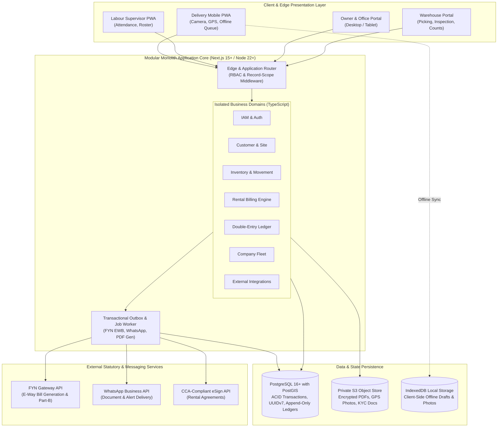
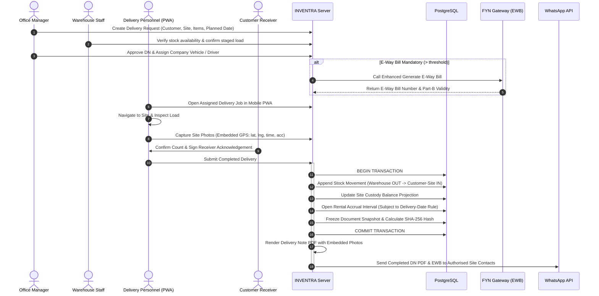
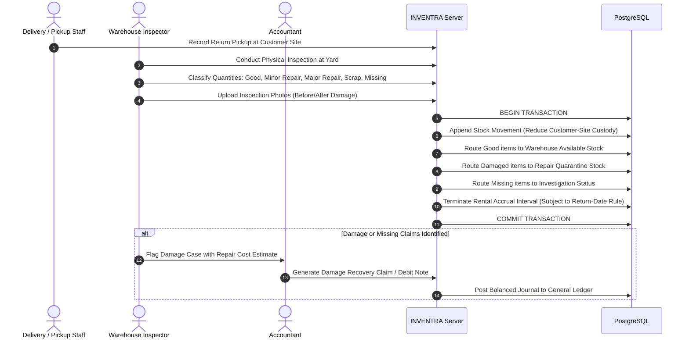

# INVENTRA – System Architecture & Technology Strategy

**Document Version**: 1.0  
**Operating Business**: AJAY ENTERPRISES  
**Architectural Pattern**: Domain-Driven Modular Monolith  
**Reference Document**: Master Blueprint v1.0 (`docs/references/INVENTRA_Master_Software_Blueprint_v1.0.pdf`)

---

## 1. Architectural Strategy: The Modular Monolith

INVENTRA is designed as a **TypeScript-based Modular Monolith**. 

### 1.1 Why a Modular Monolith over Microservices?
For an ERP managing interconnected construction rentals, inventory, and double-entry accounting:
1. **Atomic Transactional Integrity (ACID)**: When a Delivery Note is completed, the system must update physical stock balances, update customer-site custody positions, open a billing accrual interval, and generate audit records within a single database transaction boundary. Microservices introduce distributed transactions (sagas, 2PC), eventual consistency bugs, and network failure modes that are unacceptable for accounting and stock reconciliation.
2. **Elimination of Network Latency & Overhead**: Internal domain boundaries communicate via typed function calls and shared database connections rather than serialization/deserialization over HTTP/gRPC.
3. **Simplicity of Deployment & Maintenance**: A single unified deployment artifact minimizes infrastructure costs, streamlines CI/CD pipelines, and simplifies local development in Google Antigravity.
4. **Strict Domain Boundaries**: Although deployed as a monolith, code is structured into isolated domains (`src/modules/*`). Each module owns its business logic, schemas, and service functions, communicating with other domains strictly through typed public interfaces.



---

## 2. Technology Stack Evaluation & Decisions

| Layer | Selected Technology | Alternative Considered | Rationale & Trade-off Analysis |
| :--- | :--- | :--- | :--- |
| **Framework** | **Next.js 15+ (App Router)** | Vite + Express / NestJS | Unified full-stack TypeScript environment. Eliminates CORS and multi-port orchestration in development. React Server Components provide zero-bundle-size server rendering for heavy tables, while Client Components power interactive forms and PWAs. |
| **Managed Backend Platform** | **Supabase** | Self-hosted AWS / GCP stack | Provides enterprise PostgreSQL, managed connection pooling (Supavisor), secure Auth engine, private S3-compatible Storage, and PostGIS geospatial extension in a single unified platform. |
| **Database** | **Supabase PostgreSQL 16+** | MySQL / MongoDB | Industry standard for relational financial accounting. Strong support for ACID transactions, check constraints, row-level locks, JSONB for immutable document snapshots, and Row Level Security (RLS). |
| **Connection Pooling** | **Supavisor (Port 6543) & Direct (Port 5432)** | Single direct connection | Dual connection strategy: Connection Pooler with transaction mode for Next.js runtime and Serverless execution (`DATABASE_URL`), Direct connection for Prisma CLI migrations (`DIRECT_URL`). |
| **Spatial Engine** | **PostGIS Extension** | Haversine in app code | Native spatial index (`GIST`), coordinate distance calculations, polygon bounding, and spatial clustering for the interactive inventory location heatmap. |
| **ORM / Data Access** | **Prisma ORM** | Drizzle / TypeORM | Prisma provides an end-to-end type-safe client, robust declarative migrations, strict relational schema mapping, and transactional safety (`prisma.$transaction`). Prisma remains the primary ORM for server-side business operations. |
| **Authentication** | **Supabase Auth (@supabase/ssr)** | Custom bcrypt/JWT | Built-in email/password auth, secure password reset, email confirmation, and session cookie lifecycle via Next.js SSR middleware. Links directly to INVENTRA `User.supabaseId`. |
| **Authorization** | **INVENTRA Custom RBAC + RLS** | RLS alone | 9 corporate roles, 15 modules, 8 actions enforced server-side via `requirePermission`, backed by PostgreSQL Row Level Security policies and immutable triggers on audit events. |
| **UI Components** | **Radix UI & shadcn/ui** | Ant Design / MUI | Completely accessible, headless, unstyled primitives. Allows full visual control to match the INVENTRA navy and industrial orange branding without legacy styling bloat. |
| **Styling** | **Tailwind CSS v3.4+ / v4** | CSS Modules / Emotion | Utility-first CSS ensuring lightweight bundles, rapid responsive UI composition, consistent spacing tokens, and seamless dark-mode extensibility. |
| **Data Tables** | **TanStack Table v8** | AG-Grid / DataTables | Headless table architecture enabling server-side pagination, multi-column sorting, column filtering, column reordering, and cell formatting for complex stock registers. |
| **Form Handling** | **React Hook Form + Zod** | Formik + Yup | High performance with zero unnecessary re-renders. Zod schemas are shared isomorphically between client-side form validation and server-side API validation. |
| **File Storage** | **Supabase Storage (Private)** | Local filesystem / S3 | Private bucket (`inventra-private-documents`) with server-authorized uploads/downloads, short-lived signed URLs, MIME whitelisting, 10MB limits, and SHA-256 checksums. |
| **Background Jobs** | **PostgreSQL Job Outbox (PG-Boss)** | Celery / RabbitMQ | Utilizes PostgreSQL as the queue backend. Allows enqueueing background jobs (PDF render, WhatsApp dispatch, FYN E-Way Bill) within the same database transaction as the business event, guaranteeing zero missed events. |
| **Offline PWA Engine** | **Serwist / Workbox PWA** | Native mobile app | Allows delivery personnel and warehouse staff to install INVENTRA as a PWA on Android/iOS phones with offline asset caching and IndexedDB queueing. |

---

## 3. Modular Domain Architecture

The application is structured into clearly separated business domains under `src/modules/`:

```
src/
├── app/                          # Next.js App Router (UI routes & API routes)
│   ├── (auth)/                   # Authentication routes (login, forgot password)
│   ├── (owner)/                  # Owner / Super Admin Portal views
│   ├── (office)/                 # Office & Accountant Portal views
│   ├── (warehouse)/              # Warehouse Staff Portal views
│   ├── (delivery)/               # Delivery Personnel Mobile PWA views
│   ├── (labour)/                 # Labour Supervisor Mobile PWA views
│   └── api/                      # RESTful Route Handlers
├── modules/                      # Domain-Driven Core Modules
│   ├── auth/                     # Session, IAM, Passwords, RBAC, Record Scope
│   ├── company/                  # Company Profile, Branches, Warehouses, Bank Accounts, Series
│   ├── customer/                 # Customers, Multi-Sites, Site Owners, Site Contacts, KYC
│   ├── supplier/                 # Suppliers, Third-Party Material Owners, Hired Contracts
│   ├── inventory/                # Item Master, Categories, Variants, UOMs, Rate Versions
│   ├── movement/                 # DN, MRN, STN, HDN, HRN, Stock Movement Ledger
│   ├── rental-billing/           # Daily Accrual Engine, Date Inclusion Rules, Monthly Runs
│   ├── accounting/               # Chart of Accounts, General Ledger, Journals, Subledgers
│   ├── invoicing/                # Commercial Invoices, Credit/Debit Notes, Receipts, Payments
│   ├── fleet/                    # Company-Owned Fleet, Drivers, PUC/Fitness, Fuel Logs
│   ├── labour/                   # Worker Master, Biometric/Manual Attendance, Wage Runs
│   ├── maintenance/              # Damage Inspection, Repair Job Cards, Asset Recovery
│   ├── statutory/                # FYN Gateway E-Way Bill Integration, GST Tax Engine
│   ├── integrations/             # WhatsApp Business API, CCA eSign Provider
│   └── reporting/                # Financial Reports, Heatmap Geospatial Projections
├── lib/                          # Shared Infrastructure & Utilities
│   ├── db/                       # Prisma client & PostgreSQL connection pool
│   ├── storage/                  # S3 storage client & pre-signed URL generator
│   ├── jobs/                     # PG-Boss worker definitions & job dispatcher
│   ├── pdf/                      # React-PDF / Chromium template rendering engine
│   ├── geo/                      # PostGIS queries & GPS distance utilities
│   └── security/                 # Encryption, hashing, token verification
└── components/                   # Shared UI Components (shadcn/ui + custom)
    ├── forms/                    # SearchableCombobox, DatePicker, MultiSelect, FormField
    ├── tables/                   # DataTable, TablePagination, ColumnFilter
    ├── feedback/                 # AlertBanner, ConfirmDialog, LoadingSpinner
    └── layout/                   # Sidebar, Topbar, MobileNav, PortalShell
```

---

## 4. Core End-to-End Execution Workflows

### 4.1 Delivery Note (DN) & GPS Evidence Workflow



### 4.2 Material Return Note (MRN) & Inspection Workflow



---

## 5. Offline-Capable Field Operations (Delivery & Warehouse PWAs)

Field personnel frequently encounter poor cellular connectivity at basement construction sites and remote yards. INVENTRA implements an **Offline-First PWA Architecture**:

1. **Local State Cache**: Assigned delivery jobs, basic customer/site addresses, and item variant lists are cached in the browser's **IndexedDB** using local key-value stores.
2. **Offline Photo & Signature Capture**: Photos captured via the HTML5 Camera API are stored locally as compressed Blobs in IndexedDB along with hardware GPS coordinates (`navigator.geolocation`) and timestamp.
3. **Optimistic Queueing**: When the driver taps "Submit Delivery" while offline, the payload is serialized into a persistent `SyncQueue` with state `PENDING_SYNC`. The UI immediately confirms local capture.
4. **Reconnection & Conflict Resolution**:
   - The Service Worker detects connectivity via `navigator.onLine` and `visibilitychange` events.
   - The sync worker transmits queued records sequentially using an `Idempotency-Key` header.
   - The server validates stock versions, document series, and driver assignment.
   - If stock or status has changed (conflict), the server preserves the submission in an `APPROVAL_REVIEW` state rather than failing silently, alerting the Office Manager for manual reconciliation.

---

## 6. High Availability, Backup & Disaster Recovery

1. **Automated Database Backups**:
   - Daily full backups with Point-in-Time Recovery (PITR) via write-ahead logging (WAL).
   - Automated weekly restore drills to a staging environment to verify backup integrity.
2. **Object Store Redundancy**:
   - All uploaded KYC files, signed contracts, delivery photos, and generated PDFs are stored in S3 with versioning enabled and cross-region replication.
3. **Environment Isolation**:
   - Strict separation between `development`, `staging`, and `production`.
   - Production database credentials, FYN Gateway API keys, and WhatsApp tokens are injected strictly via encrypted environment variables. Zero credentials in git.

