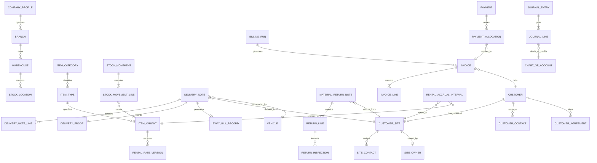

# INVENTRA – Database Architecture & Entity Specifications

**Document Version**: 1.0  
**Operating Business**: AJAY ENTERPRISES  
**Database Engine**: PostgreSQL 16+ with PostGIS  
**Data Integrity Paradigm**: Relational Source-of-Truth, Append-Only Movement/Ledgers, Calculated Projections  
**Reference Document**: Master Blueprint v1.0 (`docs/references/INVENTRA_Master_Software_Blueprint_v1.0.pdf`)

---

## 1. Core Database Design Philosophy

INVENTRA's database is designed for enterprise-grade transactional consistency, statutory audit compliance, and non-repudiation.

### 1.1 Fundamental Data Principles
1. **Append-Only Event Ledgers**:
   - Stock balances and accounting balances are **never** manually editable table columns.
   - All physical inventory movements exist as immutable rows in `stock_movements` and `stock_movement_lines`. Current warehouse and site stocks are calculated projections.
   - All financial balances exist as immutable rows in `journal_entries` and `journal_lines`. Subledgers are verified projections.
2. **Primary Key Strategy: UUIDv7**:
   - Every primary key uses **UUIDv7**. UUIDv7 encodes a Unix millisecond timestamp in the leading 48 bits, providing strict chronological sorting, preventing B-Tree index fragmentation in PostgreSQL, and allowing client-side ID generation for offline PWA sync without key collisions.
3. **Sequential Business Document Numbers**:
   - Human-readable document numbers (e.g. `DN-2026-0001`, `INV-2026-0001`, `MRN-2026-0001`) are managed by a concurrency-safe `document_series` table with row-level pessimistic locking (`SELECT ... FOR UPDATE`) scoped by financial year and branch.
4. **Absolute Monetary Precision**:
   - All financial amounts use `DECIMAL(15, 2)` (INR currency). Floating-point data types (`FLOAT`, `REAL`, `DOUBLE`) are strictly forbidden.
   - All material quantities, dimensions, and weights use `DECIMAL(12, 3)`.
5. **Timezone Standardization**:
   - All timestamps are stored as `TIMESTAMP WITH TIME ZONE` (UTC). Conversions to Indian Standard Time (`Asia/Kolkata`, UTC+05:30) are performed at the presentation/query layer.
6. **Historical Immutability & Document Snapshots**:
   - Finalized commercial documents store a full JSONB snapshot (`snapshot_payload`) of all involved legal entities, addresses, tax rates, signatory images, and line items at the moment of issue. Changes to company profile or customer master data never alter previously issued historical documents.
7. **Supabase Managed PostgreSQL & PostGIS Extension**:
   - Managed on Supabase with native PostgreSQL 16+ and PostGIS enabled (`CREATE EXTENSION IF NOT EXISTS postgis;`) for warehouse coordinates, customer construction site mapping, and geographic heatmap analytics.
   - Dual connection architecture: Supavisor connection pooler (`DATABASE_URL`, port 6543, pgbouncer=true) for high-concurrency App Router runtime, and direct connection (`DIRECT_URL`, port 5432) for Prisma migrations and schema push.
8. **Supabase Auth & Private Storage Integration**:
   - Identity management delegates password security to Supabase Auth. The application `User` entity links to `auth.users.id` via `supabaseId UUID UNIQUE`.
   - Document files, KYC proofs, and signatory assets reside in private Supabase Storage buckets (`inventra-private-documents`), accessed via short-lived signed URLs.
   - Row Level Security (RLS) policies guard all database tables and storage objects against direct client tampering.

---

## 2. Conceptual Entity-Relationship Model



---

## 3. Comprehensive Entity Schema Specifications

### 3.1 Company Profile & Business Settings Domain

```sql
-- 1. Company Profile (Single-entity singleton for AJAY ENTERPRISES)
CREATE TABLE company_profiles (
    id UUID PRIMARY KEY DEFAULT gen_random_uuid(), -- UUIDv7
    legal_name VARCHAR(255) NOT NULL,              -- "AJAY ENTERPRISES"
    trade_name VARCHAR(255) NOT NULL,
    entity_type VARCHAR(50) NOT NULL,              -- Sole Proprietorship, Partnership, Private Limited
    establishment_date DATE,
    pan VARCHAR(10) NOT NULL,
    gstin VARCHAR(15),
    gst_registration_type VARCHAR(50),             -- Regular, Composition, Unregistered
    primary_mobile VARCHAR(15) NOT NULL,
    alternate_mobile VARCHAR(15),
    whatsapp_number VARCHAR(15) NOT NULL,
    official_email VARCHAR(255) NOT NULL,
    website VARCHAR(255),
    registered_address JSONB NOT NULL,             -- line1, line2, city, district, state, state_code, pin, country
    billing_address JSONB NOT NULL,
    logo_asset_url TEXT,                           -- Official AJAY ENTERPRISES logo
    created_at TIMESTAMPTZ NOT NULL DEFAULT NOW(),
    updated_at TIMESTAMPTZ NOT NULL DEFAULT NOW()
);

-- 2. Bank Accounts
CREATE TABLE bank_accounts (
    id UUID PRIMARY KEY DEFAULT gen_random_uuid(),
    company_id UUID NOT NULL REFERENCES company_profiles(id),
    bank_name VARCHAR(100) NOT NULL,
    account_holder_name VARCHAR(150) NOT NULL,
    account_number VARCHAR(50) NOT NULL,
    ifsc_code VARCHAR(11) NOT NULL,
    branch_name VARCHAR(100),
    account_type VARCHAR(30) NOT NULL,             -- Current, Savings, Overdraft
    upi_id VARCHAR(100),
    qr_code_asset_url TEXT,                        -- Bank payment dynamic/static UPI QR
    is_primary_collection BOOLEAN NOT NULL DEFAULT FALSE,
    is_active BOOLEAN NOT NULL DEFAULT TRUE,
    created_at TIMESTAMPTZ NOT NULL DEFAULT NOW()
);

-- 3. Document Series & Numbering Sequences
CREATE TABLE document_series (
    id UUID PRIMARY KEY DEFAULT gen_random_uuid(),
    document_type VARCHAR(50) NOT NULL,            -- DN, MRN, STN, INV, REC, PAY, CN, DN_STATUTORY
    prefix VARCHAR(20) NOT NULL,                   -- e.g. "AE/DN/", "AE/INV/"
    fiscal_year VARCHAR(10) NOT NULL,              -- e.g. "2026-27"
    current_counter INTEGER NOT NULL DEFAULT 0,
    padding INTEGER NOT NULL DEFAULT 4,            -- 0001
    suffix VARCHAR(20) DEFAULT '',
    is_active BOOLEAN NOT NULL DEFAULT TRUE,
    created_at TIMESTAMPTZ NOT NULL DEFAULT NOW(),
    CONSTRAINT uq_series_type_fy UNIQUE (document_type, fiscal_year)
);

-- 4. Authorized Signatories & Seal Assets
CREATE TABLE signatory_assets (
    id UUID PRIMARY KEY DEFAULT gen_random_uuid(),
    name VARCHAR(150) NOT NULL,
    designation VARCHAR(100) NOT NULL,
    signature_image_url TEXT NOT NULL,
    company_stamp_url TEXT NOT NULL,
    is_default_signatory BOOLEAN NOT NULL DEFAULT FALSE,
    valid_from DATE NOT NULL,
    valid_until DATE,
    created_at TIMESTAMPTZ NOT NULL DEFAULT NOW()
);
```

---

### 3.2 Customer & Multi-Site Master Domain

```sql
-- 5. Customer Master
CREATE TABLE customers (
    id UUID PRIMARY KEY DEFAULT gen_random_uuid(),
    customer_code VARCHAR(50) NOT NULL UNIQUE,     -- e.g. "CUST-00102"
    company_name VARCHAR(255) NOT NULL,
    trade_name VARCHAR(255),
    customer_category VARCHAR(50) NOT NULL,        -- Developer, Contractor, Sub-Contractor, Individual
    pan VARCHAR(10),
    gst_registration_type VARCHAR(50) NOT NULL,    -- REGISTERED, UNREGISTERED, COMPOSITION
    gstin VARCHAR(15),
    primary_mobile VARCHAR(15) NOT NULL,
    alternate_mobile VARCHAR(15),
    whatsapp_number VARCHAR(15),
    email VARCHAR(255),
    registered_address JSONB NOT NULL,
    billing_address JSONB NOT NULL,
    credit_limit DECIMAL(15, 2) NOT NULL DEFAULT 0.00,
    default_billing_preference VARCHAR(30) NOT NULL DEFAULT 'CONSOLIDATED', -- CONSOLIDATED, SITE_WISE
    delivery_day_rule BOOLEAN NOT NULL DEFAULT TRUE,  -- Include delivery date by default
    return_day_rule BOOLEAN NOT NULL DEFAULT FALSE,   -- Include return date by default
    status VARCHAR(30) NOT NULL DEFAULT 'ACTIVE',     -- ACTIVE, ON_HOLD, BLACKLISTED
    created_at TIMESTAMPTZ NOT NULL DEFAULT NOW(),
    updated_at TIMESTAMPTZ NOT NULL DEFAULT NOW()
);

-- 6. Construction Sites (Unlimited per Customer)
CREATE TABLE customer_sites (
    id UUID PRIMARY KEY DEFAULT gen_random_uuid(),
    customer_id UUID NOT NULL REFERENCES customers(id) ON DELETE RESTRICT,
    site_code VARCHAR(50) NOT NULL UNIQUE,         -- e.g. "SITE-00102-01"
    site_name VARCHAR(255) NOT NULL,               -- e.g. "Prestige Sunrise Tower B"
    site_type VARCHAR(50) NOT NULL,                -- High-Rise Residential, Commercial Complex, Villa
    address_line1 TEXT NOT NULL,
    address_line2 TEXT,
    city VARCHAR(100) NOT NULL,
    district VARCHAR(100) NOT NULL,
    state VARCHAR(100) NOT NULL,
    state_code VARCHAR(5) NOT NULL,
    pincode VARCHAR(10) NOT NULL,
    location GEOGRAPHY(Point, 4326),               -- PostGIS GPS coordinates (lng, lat)
    permitted_delivery_hours VARCHAR(100),         -- e.g. "08:00 AM - 06:00 PM"
    delivery_instructions TEXT,
    opening_date DATE NOT NULL,
    expected_completion_date DATE,
    actual_closure_date DATE,
    site_delivery_day_override BOOLEAN,            -- NULL inherits customer rule
    site_return_day_override BOOLEAN,
    status VARCHAR(30) NOT NULL DEFAULT 'ACTIVE',  -- ACTIVE, COMPLETED, ON_HOLD, CLOSED_SETTLED
    created_at TIMESTAMPTZ NOT NULL DEFAULT NOW(),
    updated_at TIMESTAMPTZ NOT NULL DEFAULT NOW()
);

-- 7. Site Owner / Property Owner Details (Distinct from Customer)
CREATE TABLE site_owners (
    id UUID PRIMARY KEY DEFAULT gen_random_uuid(),
    site_id UUID NOT NULL UNIQUE REFERENCES customer_sites(id) ON DELETE CASCADE,
    is_customer_the_owner BOOLEAN NOT NULL DEFAULT FALSE,
    owner_name VARCHAR(255) NOT NULL,
    owner_type VARCHAR(50) NOT NULL,               -- Individual Landowner, Corporate Landowner, Joint Venture
    mobile VARCHAR(15),
    email VARCHAR(255),
    address TEXT,
    relationship_to_project VARCHAR(100),          -- Landowner, Project Financier, Lead Developer
    pan VARCHAR(10),
    consent_document_url TEXT,
    created_at TIMESTAMPTZ NOT NULL DEFAULT NOW()
);

-- 8. Site Contacts & Granular Permissions
CREATE TABLE site_contacts (
    id UUID PRIMARY KEY DEFAULT gen_random_uuid(),
    site_id UUID NOT NULL REFERENCES customer_sites(id) ON DELETE CASCADE,
    contact_name VARCHAR(150) NOT NULL,
    designation VARCHAR(100) NOT NULL,             -- Project Manager, Site Engineer, Storekeeper, Receiver
    mobile VARCHAR(15) NOT NULL,
    alternate_mobile VARCHAR(15),
    whatsapp_number VARCHAR(15) NOT NULL,
    email VARCHAR(255),
    can_receive_goods BOOLEAN NOT NULL DEFAULT TRUE,
    can_sign_delivery_notes BOOLEAN NOT NULL DEFAULT TRUE,
    can_request_returns BOOLEAN NOT NULL DEFAULT FALSE,
    can_approve_transfers BOOLEAN NOT NULL DEFAULT FALSE,
    can_receive_invoices BOOLEAN NOT NULL DEFAULT FALSE,
    is_primary_contact BOOLEAN NOT NULL DEFAULT FALSE,
    created_at TIMESTAMPTZ NOT NULL DEFAULT NOW()
);

-- 9. Customer & Site Attachments
CREATE TABLE attachments (
    id UUID PRIMARY KEY DEFAULT gen_random_uuid(),
    entity_type VARCHAR(50) NOT NULL,              -- CUSTOMER, SITE, DN, MRN, REPAIR, WORKER
    entity_id UUID NOT NULL,
    category VARCHAR(50) NOT NULL,                 -- PAN, GST_CERT, SITE_PHOTO, ACCESS_ROUTE, CONTRACT
    file_name VARCHAR(255) NOT NULL,
    file_mime_type VARCHAR(100) NOT NULL,
    file_size_bytes BIGINT NOT NULL,
    storage_key TEXT NOT NULL,                     -- S3 object key
    sha256_hash VARCHAR(64) NOT NULL,
    expiry_date DATE,
    uploader_user_id UUID NOT NULL,
    is_private BOOLEAN NOT NULL DEFAULT TRUE,
    created_at TIMESTAMPTZ NOT NULL DEFAULT NOW()
);
```

---

### 3.3 Item Master & Inventory Movement Ledger Domain

```sql
-- 10. Material Hierarchy: Categories & Variants
CREATE TABLE item_categories (
    id UUID PRIMARY KEY DEFAULT gen_random_uuid(),
    name VARCHAR(100) NOT NULL UNIQUE,             -- Props, Sapan, Scaffolding Sheets, Column Boxes
    code VARCHAR(20) NOT NULL UNIQUE,
    description TEXT,
    is_active BOOLEAN NOT NULL DEFAULT TRUE
);

CREATE TABLE item_types (
    id UUID PRIMARY KEY DEFAULT gen_random_uuid(),
    category_id UUID NOT NULL REFERENCES item_categories(id),
    name VARCHAR(100) NOT NULL,                    -- Adjustable Steel Props, Beam Sapan, Steel Shuttering Plate
    code VARCHAR(30) NOT NULL UNIQUE
);

CREATE TABLE item_variants (
    id UUID PRIMARY KEY DEFAULT gen_random_uuid(),
    type_id UUID NOT NULL REFERENCES item_types(id),
    variant_code VARCHAR(50) NOT NULL UNIQUE,      -- PROP-2X2, PROP-2X3, SAPAN-8FT, SHEET-3X2
    name VARCHAR(150) NOT NULL,                    -- "Steel Prop 2.0m to 3.0m Heavy Duty"
    dimensions JSONB NOT NULL,                     -- length, width, thickness, outer_dia, inner_dia
    unit_of_measure VARCHAR(20) NOT NULL,          -- NOS, SQFT, KGS, SET
    hsn_sac_code VARCHAR(10) NOT NULL,             -- e.g. "73084000" (Scaffolding equipment)
    standard_weight_kg DECIMAL(10, 3) NOT NULL,
    default_daily_rental_rate DECIMAL(15, 2) NOT NULL,
    purchase_cost DECIMAL(15, 2) NOT NULL,
    replacement_value DECIMAL(15, 2) NOT NULL,     -- Value charged on customer loss/damage
    is_active BOOLEAN NOT NULL DEFAULT TRUE,
    created_at TIMESTAMPTZ NOT NULL DEFAULT NOW()
);

-- 11. Rate History & Effective Versioning
CREATE TABLE rental_rate_versions (
    id UUID PRIMARY KEY DEFAULT gen_random_uuid(),
    item_variant_id UUID NOT NULL REFERENCES item_variants(id),
    customer_id UUID REFERENCES customers(id),     -- NULL means general baseline rate
    daily_rate DECIMAL(15, 2) NOT NULL,
    effective_from DATE NOT NULL,
    effective_until DATE,
    approved_by_user_id UUID NOT NULL,
    created_at TIMESTAMPTZ NOT NULL DEFAULT NOW()
);

-- 12. Storage Locations (Warehouses & Customer Sites)
CREATE TABLE storage_locations (
    id UUID PRIMARY KEY DEFAULT gen_random_uuid(),
    location_type VARCHAR(30) NOT NULL,            -- WAREHOUSE, CUSTOMER_SITE, QUARANTINE_REPAIR, IN_TRANSIT
    warehouse_id UUID,                             -- Links to branches/warehouses
    customer_site_id UUID REFERENCES customer_sites(id),
    name VARCHAR(150) NOT NULL,
    is_active BOOLEAN NOT NULL DEFAULT TRUE
);

-- 13. Append-Only Stock Movement Events (Single Source of Truth)
CREATE TABLE stock_movements (
    id UUID PRIMARY KEY DEFAULT gen_random_uuid(),
    movement_number VARCHAR(50) NOT NULL UNIQUE,   -- e.g. "SM-2026-00045"
    movement_type VARCHAR(50) NOT NULL,            -- DELIVERY, RETURN, TRANSFER, GRN, ADJUSTMENT, SCRAP
    reference_document_type VARCHAR(50) NOT NULL,  -- DN, MRN, STN, GRN, DAMAGE_CASE
    reference_document_id UUID NOT NULL,
    source_location_id UUID NOT NULL REFERENCES storage_locations(id),
    destination_location_id UUID NOT NULL REFERENCES storage_locations(id),
    movement_timestamp TIMESTAMPTZ NOT NULL,
    recorded_by_user_id UUID NOT NULL,
    status VARCHAR(30) NOT NULL DEFAULT 'COMMITTED',
    notes TEXT,
    created_at TIMESTAMPTZ NOT NULL DEFAULT NOW()
);

CREATE TABLE stock_movement_lines (
    id UUID PRIMARY KEY DEFAULT gen_random_uuid(),
    movement_id UUID NOT NULL REFERENCES stock_movements(id) ON DELETE CASCADE,
    item_variant_id UUID NOT NULL REFERENCES item_variants(id),
    quantity DECIMAL(12, 3) NOT NULL CHECK (quantity > 0),
    ownership_source VARCHAR(30) NOT NULL,         -- OWNED_AJAY_ENTERPRISES, HIRED_IN, THIRD_PARTY
    third_party_owner_id UUID,                     -- Links to supplier if HIRED_IN
    stock_condition VARCHAR(30) NOT NULL DEFAULT 'GOOD' -- GOOD, MINOR_DAMAGE, MAJOR_DAMAGE, SCRAP
);

-- 14. Stock Balance Projection Table (Fast Indexed Read Cache)
CREATE TABLE stock_balance_projections (
    id UUID PRIMARY KEY DEFAULT gen_random_uuid(),
    storage_location_id UUID NOT NULL REFERENCES storage_locations(id),
    item_variant_id UUID NOT NULL REFERENCES item_variants(id),
    ownership_source VARCHAR(30) NOT NULL,
    stock_status VARCHAR(30) NOT NULL,             -- AVAILABLE, IN_TRANSIT, AT_SITE_RENTED, IN_REPAIR, SCRAPPED
    current_quantity DECIMAL(12, 3) NOT NULL DEFAULT 0.000,
    last_movement_id UUID NOT NULL REFERENCES stock_movements(id),
    updated_at TIMESTAMPTZ NOT NULL DEFAULT NOW(),
    CONSTRAINT uq_balance_dimension UNIQUE (storage_location_id, item_variant_id, ownership_source, stock_status)
);
```

---

### 3.4 Delivery Notes, Material Returns & Logistics Domain

```sql
-- 15. Delivery Notes (Dispatches)
CREATE TABLE delivery_notes (
    id UUID PRIMARY KEY DEFAULT gen_random_uuid(),
    dn_number VARCHAR(50) NOT NULL UNIQUE,         -- "DN-2026-0001"
    customer_id UUID NOT NULL REFERENCES customers(id),
    site_id UUID NOT NULL REFERENCES customer_sites(id),
    source_warehouse_id UUID NOT NULL,
    vehicle_id UUID NOT NULL,                      -- Company-owned vehicle only
    driver_id UUID NOT NULL,
    dispatch_timestamp TIMESTAMPTZ,
    arrival_timestamp TIMESTAMPTZ,
    status VARCHAR(30) NOT NULL DEFAULT 'DRAFT',   -- DRAFT, CONFIRMED, LOADED, IN_TRANSIT, DELIVERED, CANCELLED
    delivery_day_rule_applied BOOLEAN NOT NULL,
    return_day_rule_applied BOOLEAN NOT NULL,
    snapshot_payload JSONB,                        -- Freezes company, site, item details on completion
    document_hash VARCHAR(64),                     -- SHA-256 hash of final PDF
    pdf_asset_url TEXT,
    created_by_user_id UUID NOT NULL,
    created_at TIMESTAMPTZ NOT NULL DEFAULT NOW(),
    updated_at TIMESTAMPTZ NOT NULL DEFAULT NOW()
);

CREATE TABLE delivery_note_lines (
    id UUID PRIMARY KEY DEFAULT gen_random_uuid(),
    delivery_note_id UUID NOT NULL REFERENCES delivery_notes(id) ON DELETE CASCADE,
    item_variant_id UUID NOT NULL REFERENCES item_variants(id),
    dispatched_quantity DECIMAL(12, 3) NOT NULL,
    delivered_quantity DECIMAL(12, 3) NOT NULL DEFAULT 0.000,
    rejected_quantity DECIMAL(12, 3) NOT NULL DEFAULT 0.000,
    daily_rental_rate DECIMAL(15, 2) NOT NULL,
    ownership_source VARCHAR(30) NOT NULL DEFAULT 'OWNED_AJAY_ENTERPRISES'
);

-- 16. Delivery Proof (GPS Photos & Acknowledgement)
CREATE TABLE delivery_proofs (
    id UUID PRIMARY KEY DEFAULT gen_random_uuid(),
    delivery_note_id UUID NOT NULL UNIQUE REFERENCES delivery_notes(id) ON DELETE CASCADE,
    receiver_name VARCHAR(150) NOT NULL,
    receiver_mobile VARCHAR(15) NOT NULL,
    receiver_designation VARCHAR(100),
    receiver_signature_url TEXT NOT NULL,
    capture_timestamp TIMESTAMPTZ NOT NULL,
    captured_latitude DECIMAL(10, 8) NOT NULL,
    captured_longitude DECIMAL(11, 8) NOT NULL,
    gps_accuracy_meters DECIMAL(8, 2),
    location_point GEOGRAPHY(Point, 4326),
    site_distance_discrepancy_meters DECIMAL(10, 2), -- Distance between captured GPS and site registered GPS
    photo_urls JSONB NOT NULL,                      -- Array of S3 URLs with captured vehicle/site/material photos
    driver_notes TEXT,
    created_at TIMESTAMPTZ NOT NULL DEFAULT NOW()
);

-- 17. Material Return Notes (Returns & Inbound Yard Inspection)
CREATE TABLE material_return_notes (
    id UUID PRIMARY KEY DEFAULT gen_random_uuid(),
    mrn_number VARCHAR(50) NOT NULL UNIQUE,        -- "MRN-2026-0001"
    customer_id UUID NOT NULL REFERENCES customers(id),
    site_id UUID NOT NULL REFERENCES customer_sites(id),
    destination_warehouse_id UUID NOT NULL,
    vehicle_id UUID NOT NULL,
    driver_id UUID NOT NULL,
    received_timestamp TIMESTAMPTZ NOT NULL,
    status VARCHAR(30) NOT NULL DEFAULT 'DRAFT',   -- DRAFT, INSPECTED, COMMITTED, CANCELLED
    return_day_rule_applied BOOLEAN NOT NULL,
    inspector_user_id UUID NOT NULL,
    document_hash VARCHAR(64),
    pdf_asset_url TEXT,
    created_at TIMESTAMPTZ NOT NULL DEFAULT NOW()
);

CREATE TABLE material_return_lines (
    id UUID PRIMARY KEY DEFAULT gen_random_uuid(),
    return_note_id UUID NOT NULL REFERENCES material_return_notes(id) ON DELETE CASCADE,
    item_variant_id UUID NOT NULL REFERENCES item_variants(id),
    claimed_returned_quantity DECIMAL(12, 3) NOT NULL,
    good_quantity DECIMAL(12, 3) NOT NULL DEFAULT 0.000,
    minor_damage_quantity DECIMAL(12, 3) NOT NULL DEFAULT 0.000,
    major_damage_quantity DECIMAL(12, 3) NOT NULL DEFAULT 0.000,
    scrap_quantity DECIMAL(12, 3) NOT NULL DEFAULT 0.000,
    missing_quantity DECIMAL(12, 3) NOT NULL DEFAULT 0.000,
    inspection_notes TEXT
);
```

---

### 3.5 Monthly Rental Billing Engine Domain

```sql
-- 18. Daily Material Custody Accrual Tracking
CREATE TABLE rental_accrual_intervals (
    id UUID PRIMARY KEY DEFAULT gen_random_uuid(),
    customer_id UUID NOT NULL REFERENCES customers(id),
    site_id UUID NOT NULL REFERENCES customer_sites(id),
    item_variant_id UUID NOT NULL REFERENCES item_variants(id),
    delivery_note_id UUID NOT NULL REFERENCES delivery_notes(id),
    material_return_note_id UUID REFERENCES material_return_notes(id),
    ownership_source VARCHAR(30) NOT NULL,
    effective_daily_rate DECIMAL(15, 2) NOT NULL,
    interval_start_date DATE NOT NULL,             -- Evaluated using delivery_day_rule
    interval_end_date DATE,                        -- NULL if unreturned; evaluated using return_day_rule
    quantity_held DECIMAL(12, 3) NOT NULL,
    is_closed BOOLEAN NOT NULL DEFAULT FALSE,
    created_at TIMESTAMPTZ NOT NULL DEFAULT NOW()
);

-- 19. Billing Runs & Invoices
CREATE TABLE billing_runs (
    id UUID PRIMARY KEY DEFAULT gen_random_uuid(),
    billing_run_number VARCHAR(50) NOT NULL UNIQUE,-- "BR-2026-10"
    billing_month DATE NOT NULL,                   -- First day of billing month (e.g. 2026-10-01)
    period_start_date DATE NOT NULL,
    period_end_date DATE NOT NULL,
    executed_by_user_id UUID NOT NULL,
    total_customers_billed INTEGER NOT NULL DEFAULT 0,
    total_rental_amount DECIMAL(15, 2) NOT NULL DEFAULT 0.00,
    status VARCHAR(30) NOT NULL DEFAULT 'PREVIEW', -- PREVIEW, FINALIZED, POSTED
    created_at TIMESTAMPTZ NOT NULL DEFAULT NOW()
);

CREATE TABLE billing_coverages (
    id UUID PRIMARY KEY DEFAULT gen_random_uuid(),
    billing_run_id UUID NOT NULL REFERENCES billing_runs(id),
    accrual_interval_id UUID NOT NULL REFERENCES rental_accrual_intervals(id),
    billed_start_date DATE NOT NULL,
    billed_end_date DATE NOT NULL,
    billable_days INTEGER NOT NULL,
    quantity DECIMAL(12, 3) NOT NULL,
    daily_rate DECIMAL(15, 2) NOT NULL,
    line_rental_total DECIMAL(15, 2) NOT NULL,
    invoice_line_id UUID,                          -- Attached once invoice is generated
    CONSTRAINT uq_coverage_unique UNIQUE (accrual_interval_id, billed_start_date, billed_end_date)
);

CREATE TABLE invoices (
    id UUID PRIMARY KEY DEFAULT gen_random_uuid(),
    invoice_number VARCHAR(50) NOT NULL UNIQUE,    -- "INV-2026-0001"
    invoice_type VARCHAR(30) NOT NULL,             -- MONTHLY_RENTAL, SALES, HIRING, DAMAGE_RECOVERY, TRANSPORT
    customer_id UUID NOT NULL REFERENCES customers(id),
    site_id UUID REFERENCES customer_sites(id),    -- NULL for consolidated multi-site invoice
    billing_run_id UUID REFERENCES billing_runs(id),
    invoice_date DATE NOT NULL,
    due_date DATE NOT NULL,
    subtotal_amount DECIMAL(15, 2) NOT NULL,
    discount_amount DECIMAL(15, 2) NOT NULL DEFAULT 0.00,
    taxable_amount DECIMAL(15, 2) NOT NULL,
    cgst_amount DECIMAL(15, 2) NOT NULL DEFAULT 0.00,
    sgst_amount DECIMAL(15, 2) NOT NULL DEFAULT 0.00,
    igst_amount DECIMAL(15, 2) NOT NULL DEFAULT 0.00,
    total_amount DECIMAL(15, 2) NOT NULL,
    paid_amount DECIMAL(15, 2) NOT NULL DEFAULT 0.00,
    outstanding_amount DECIMAL(15, 2) NOT NULL,
    payment_status VARCHAR(30) NOT NULL DEFAULT 'UNPAID', -- UNPAID, PARTIALLY_PAID, PAID, CANCELLED
    journal_entry_id UUID,                         -- Linked General Ledger entry
    snapshot_payload JSONB NOT NULL,
    document_hash VARCHAR(64) NOT NULL,
    pdf_asset_url TEXT,
    created_at TIMESTAMPTZ NOT NULL DEFAULT NOW(),
    updated_at TIMESTAMPTZ NOT NULL DEFAULT NOW()
);

CREATE TABLE invoice_lines (
    id UUID PRIMARY KEY DEFAULT gen_random_uuid(),
    invoice_id UUID NOT NULL REFERENCES invoices(id) ON DELETE CASCADE,
    site_id UUID REFERENCES customer_sites(id),    -- Displays site breakdown on consolidated invoice
    item_variant_id UUID REFERENCES item_variants(id),
    description TEXT NOT NULL,
    hsn_sac_code VARCHAR(10) NOT NULL,
    quantity DECIMAL(12, 3) NOT NULL,
    billable_days INTEGER,
    unit_rate DECIMAL(15, 2) NOT NULL,
    gross_amount DECIMAL(15, 2) NOT NULL,
    gst_rate DECIMAL(5, 2) NOT NULL,               -- e.g. 18.00
    cgst_amount DECIMAL(15, 2) NOT NULL DEFAULT 0.00,
    sgst_amount DECIMAL(15, 2) NOT NULL DEFAULT 0.00,
    igst_amount DECIMAL(15, 2) NOT NULL DEFAULT 0.00,
    total_amount DECIMAL(15, 2) NOT NULL
);
```

---

### 3.6 Double-Entry Accounting Domain

```sql
-- 20. Chart of Accounts
CREATE TABLE chart_of_accounts (
    id UUID PRIMARY KEY DEFAULT gen_random_uuid(),
    account_code VARCHAR(30) NOT NULL UNIQUE,      -- e.g. "1100-AR", "4100-RENTAL-REV", "2200-OUTPUT-CGST"
    account_name VARCHAR(150) NOT NULL,
    account_type VARCHAR(30) NOT NULL,             -- ASSET, LIABILITY, EQUITY, REVENUE, EXPENSE
    account_subgroup VARCHAR(50) NOT NULL,         -- Current Asset, Fixed Asset, Current Liability, Operating Revenue
    is_control_account BOOLEAN NOT NULL DEFAULT FALSE,
    is_active BOOLEAN NOT NULL DEFAULT TRUE,
    created_at TIMESTAMPTZ NOT NULL DEFAULT NOW()
);

-- 21. General Ledger Journals (Strict Double-Entry: sum(debits) = sum(credits))
CREATE TABLE journal_entries (
    id UUID PRIMARY KEY DEFAULT gen_random_uuid(),
    journal_number VARCHAR(50) NOT NULL UNIQUE,    -- "JRN-2026-0001"
    entry_date DATE NOT NULL,
    source_document_type VARCHAR(50) NOT NULL,     -- INVOICE, PAYMENT, RECEIPT, WAGE, DEPRECIATION
    source_document_id UUID,
    narration TEXT NOT NULL,
    total_debit DECIMAL(15, 2) NOT NULL,
    total_credit DECIMAL(15, 2) NOT NULL,
    is_reversal BOOLEAN NOT NULL DEFAULT FALSE,
    reversed_entry_id UUID REFERENCES journal_entries(id),
    posted_by_user_id UUID NOT NULL,
    created_at TIMESTAMPTZ NOT NULL DEFAULT NOW(),
    CONSTRAINT chk_balanced_journal CHECK (total_debit = total_credit)
);

CREATE TABLE journal_lines (
    id UUID PRIMARY KEY DEFAULT gen_random_uuid(),
    journal_entry_id UUID NOT NULL REFERENCES journal_entries(id) ON DELETE CASCADE,
    account_id UUID NOT NULL REFERENCES chart_of_accounts(id),
    debit_amount DECIMAL(15, 2) NOT NULL DEFAULT 0.00,
    credit_amount DECIMAL(15, 2) NOT NULL DEFAULT 0.00,
    customer_id UUID REFERENCES customers(id),
    site_id UUID REFERENCES customer_sites(id),
    supplier_id UUID,
    vehicle_id UUID,
    description TEXT,
    CONSTRAINT chk_debit_or_credit CHECK (
        (debit_amount > 0 AND credit_amount = 0) OR
        (credit_amount > 0 AND debit_amount = 0)
    )
);

-- 22. Payments & Receipts
CREATE TABLE payments (
    id UUID PRIMARY KEY DEFAULT gen_random_uuid(),
    payment_number VARCHAR(50) NOT NULL UNIQUE,    -- "REC-2026-0001" or "PAY-2026-0001"
    payment_type VARCHAR(20) NOT NULL,             -- RECEIPT (from customer), PAYMENT (to supplier/labour)
    customer_id UUID REFERENCES customers(id),
    supplier_id UUID,
    payment_date DATE NOT NULL,
    amount DECIMAL(15, 2) NOT NULL CHECK (amount > 0),
    payment_mode VARCHAR(30) NOT NULL,             -- NEFT, RTGS, IMPS, UPI, CHEQUE, CASH
    bank_account_id UUID REFERENCES bank_accounts(id),
    reference_number VARCHAR(100),                 -- UTR or Cheque number
    unallocated_amount DECIMAL(15, 2) NOT NULL DEFAULT 0.00,
    journal_entry_id UUID REFERENCES journal_entries(id),
    created_at TIMESTAMPTZ NOT NULL DEFAULT NOW()
);

CREATE TABLE payment_allocations (
    id UUID PRIMARY KEY DEFAULT gen_random_uuid(),
    payment_id UUID NOT NULL REFERENCES payments(id) ON DELETE CASCADE,
    invoice_id UUID NOT NULL REFERENCES invoices(id),
    allocated_amount DECIMAL(15, 2) NOT NULL CHECK (allocated_amount > 0),
    created_at TIMESTAMPTZ NOT NULL DEFAULT NOW()
);
```

---

### 3.7 Integrations, Statutory E-Way Bill & Audit Domain

```sql
-- 23. FYN Gateway E-Way Bill Integration Logs
CREATE TABLE eway_bill_records (
    id UUID PRIMARY KEY DEFAULT gen_random_uuid(),
    delivery_note_id UUID NOT NULL REFERENCES delivery_notes(id),
    eway_bill_number VARCHAR(20) NOT NULL UNIQUE,  -- 12-digit EBN
    eway_bill_date TIMESTAMPTZ NOT NULL,
    valid_until TIMESTAMPTZ NOT NULL,
    vehicle_number VARCHAR(20) NOT NULL,
    from_pincode VARCHAR(10) NOT NULL,
    to_pincode VARCHAR(10) NOT NULL,
    distance_km INTEGER NOT NULL,
    status VARCHAR(30) NOT NULL DEFAULT 'ACTIVE',  -- ACTIVE, CANCELLED, EXPIRED
    fyn_request_correlation_id VARCHAR(100),
    fyn_raw_response JSONB NOT NULL,
    pdf_asset_url TEXT,
    created_at TIMESTAMPTZ NOT NULL DEFAULT NOW()
);

-- 24. Audit Event Trail (Tamper-Evident System Log)
CREATE TABLE audit_events (
    id UUID PRIMARY KEY DEFAULT gen_random_uuid(),
    actor_user_id UUID NOT NULL,
    actor_ip_address VARCHAR(45) NOT NULL,
    actor_user_agent TEXT,
    action VARCHAR(50) NOT NULL,                   -- CREATE, UPDATE, POST, CANCEL, PRINT, EXPORT, DOWNLOAD_KYC
    entity_type VARCHAR(50) NOT NULL,              -- DELIVERY_NOTE, INVOICE, JOURNAL, CUSTOMER, RATE
    entity_id UUID NOT NULL,
    before_state JSONB,                            -- NULL on create
    after_state JSONB,
    change_reason TEXT,
    created_at TIMESTAMPTZ NOT NULL DEFAULT NOW()
);
```

---

## 4. Key Performance Indexes & Constraints

```sql
-- Spatial Index for PostGIS Heatmap Queries
CREATE INDEX idx_customer_sites_location ON customer_sites USING GIST(location);

-- Stock Ledger Fast Traversal Indexes
CREATE INDEX idx_stock_mov_lines_item ON stock_movement_lines(item_variant_id);
CREATE INDEX idx_stock_movements_timestamp ON stock_movements(movement_timestamp);

-- Accrual Intervals Query Indexes
CREATE INDEX idx_accrual_active ON rental_accrual_intervals(customer_id, site_id, is_closed);
CREATE INDEX idx_accrual_date_range ON rental_accrual_intervals(interval_start_date, interval_end_date);

-- Double-Entry Ledger Performance Indexes
CREATE INDEX idx_journal_lines_account ON journal_lines(account_id);
CREATE INDEX idx_journal_lines_customer ON journal_lines(customer_id);
CREATE INDEX idx_journal_entries_date ON journal_entries(entry_date);

-- Invoices & Receivables Ageing Indexes
CREATE INDEX idx_invoices_customer_status ON invoices(customer_id, payment_status);
CREATE INDEX idx_invoices_due_date ON invoices(due_date);
```

