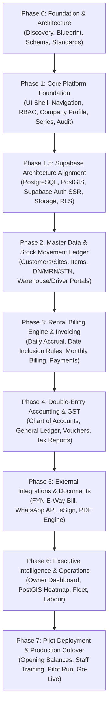

# INVENTRA – Phased Implementation Roadmap & Release Gates

**Document Version**: 1.0  
**Operating Business**: AJAY ENTERPRISES  
**Software Brand**: INVENTRA  
**Development Methodology**: Milestone-Driven Modular Implementation with Strict Verification Gates  
**Reference Document**: Master Blueprint v1.0 (`docs/references/INVENTRA_Master_Software_Blueprint_v1.0.pdf`)

---

## 1. Roadmap Overview & Strategic Dependency Sequence

Building an enterprise ERP for centering material rental requires strict architectural discipline. In accordance with Section 13 of the Master Blueprint, INVENTRA is constructed in **dependency order**. Business modules are not introduced before their foundation is tested and stable.

---

## 2. Detailed Phase Specifications & Release Gates

### Phase 0: Project Foundation & Architecture (COMPLETED)
- **Primary Objective**: Establish the complete technical, operational, and architectural foundation before writing application code.
- **Key Deliverables**:
  - Comprehensive inspection of workspace and developer tools.
  - Final technology stack selection and trade-off evaluation.
  - Complete data model, entity specifications, and PostGIS schema.
  - Core business rules, rental calculation models, and accounting posting matrix.
  - UI/UX design standards, component guidelines, and form specifications.
  - Permanent project instruction file (`AGENTS.md`) and complete `docs/` documentation suite.
- **Verification & Exit Gate**:
  - [x] Zero contradictions across documentation.
  - [x] Permanent business rules codified (No QR codes, company fleet only, independent date inclusion, double-entry GL).
  - [x] Stakeholder open decisions register documented.

---

### Phase 1: Platform Foundation & Core Services (COMPLETED)
- **Primary Objective**: Build the core application runtime, authentication, role-based authorization, and central configuration.
- **Key Deliverables**:
  - Next.js 15+ App Router scaffold with TypeScript, Tailwind CSS, and Radix UI.
  - Prisma ORM configuration with SQLite for local standalone development and PostgreSQL/PostGIS schema.
  - Multi-portal session authentication with bcryptjs password hashing and JWT session cookies.
  - Role-Based Access Control (RBAC) enforcing 9 portal roles and 4 record-level scopes (`ALL_BUSINESS`, `ASSIGNED_WAREHOUSE`, `ASSIGNED_SITE`, `ASSIGNED_DELIVERY`).
  - AJAY ENTERPRISES Company Profile management (legal name, addresses, GSTIN, PAN, bank accounts, logo, signatories, stamps).
  - Document Series generator with atomic transactions for sequential document numbers (`PREFIX-YYYY-NNNN`) and live preview.
  - Private object storage service with MIME validation and size limits.
  - Tamper-evident Audit Logging service (`audit_events`) with sensitive data redaction.
- **Verification & Exit Gate**:
  - [x] Authentication verified across 9 roles; unauthorized actions return HTTP 403.
  - [x] AJAY ENTERPRISES company profile, addresses, bank accounts, and signatories successfully configured.
  - [x] Concurrent document series generation test produces zero duplicate document numbers.
  - [x] Private file upload/download and MIME validation verified.
  - [x] 18 automated tests in 8 suites passing cleanly with zero failures.
  - [x] TypeScript compilation (`tsc --noEmit`) passes with zero errors.

---

### Phase 1.5: Supabase Architecture Alignment (COMPLETED)
- **Primary Objective**: Align INVENTRA's core foundation with Supabase as the managed backend platform (PostgreSQL, PostGIS, Supabase Auth SSR, Supabase Storage, and RLS).
- **Key Deliverables**:
  - Prisma Schema migrated from SQLite to Supabase PostgreSQL 16+ with PostGIS extension (`extensions = [postgis]`, `previewFeatures = ["postgresqlExtensions"]`).
  - Dual connection architecture configured: Supavisor connection pooler (`DATABASE_URL`, port 6543, pgbouncer) for Next.js runtime, direct connection (`DIRECT_URL`, port 5432) for Prisma CLI migrations.
  - Native PostgreSQL UUIDs (`@db.Uuid`) and financial precision (`DECIMAL(15, 2)`, `DECIMAL(10, 7)`) enforced across models.
  - Authentication migrated to Supabase Auth (`@supabase/ssr` + Next.js middleware) linking `auth.users.id` with `User.supabaseId`. Secondary bcrypt password database eliminated.
  - First-owner setup workflow (`/setup`) bootstraps primary Owner in Supabase Auth and permanently locks with HTTP 403.
  - File storage migrated to Supabase Storage (`inventra-private-documents` private bucket) with server-side authorization, MIME validation, 10MB limits, SHA-256 checksumming, and short-lived pre-signed URLs.
  - PostgreSQL Row Level Security (RLS) policies and append-only database immutability trigger created for `AuditEvent`.
  - Comprehensive automated test suite expanded to 43 passing tests across 17 suites (`tests/supabase-alignment.test.js`).
- **Verification & Exit Gate**:
  - [x] Prisma validation (`npx prisma validate`) succeeds with PostGIS and PostgreSQL extensions.
  - [x] Prisma client generation (`npx prisma generate`) completes cleanly.
  - [x] TypeScript compilation (`npx tsc --noEmit`) passes with 0 errors.
  - [x] All 43 automated tests across 17 test suites pass with 0 failures (`npm test`).
  - [x] Production build (`npm run build`) compiles all 38 static and dynamic routes cleanly.

---

### Phase 2: Master Data & Inventory Movement Ledger
- **Primary Objective**: Implement customer/site masters, item hierarchy, and the append-only stock movement ledger.
- **Key Deliverables**:
  - Customer & Multi-Site Master: Unlimited construction sites per customer, property owner details, site contacts, delivery instructions, and KYC attachments.
  - Supplier & Third-Party Material Owner Master: Vendor records and hired-in contract tracking.
  - Item Master & Rental Rates: Category $\to$ Type $\to$ Variant hierarchy with dimension attributes and effective-dated rate history.
  - Warehouse & Storage Locations: Multiple yards, storage racks, and customer site location mapping.
  - Append-Only Stock Movement Engine: `stock_movements` and `stock_movement_lines` tracking dispatches, returns, transfers, and adjustments.
  - Procurement & GRN: Purchase orders, goods receipt notes with shortage/damage logging.
  - Movement Documents: Delivery Notes (DN), Material Return Notes (MRN), Stock Transfer Notes (STN), Hiring Notes (HDN/HRN).
  - Field Portals: Delivery Personnel Mobile PWA (GPS camera photo capture, receiver signature) and Warehouse Portal (picking, loading, return inspection).
- **Verification & Exit Gate**:
  - Stock control equation reconciles: $\text{Closing} = \text{Opening} + \text{In} - \text{Out}$.
  - Customer-site custody accurately tracks delivered materials without affecting general warehouse stock.
  - Materials hired-in from third-party owners remain strictly distinguished from AJAY ENTERPRISES-owned inventory.
  - Partial delivery and partial return test scenarios pass with zero stock leaks.

---

### Phase 3: Rental Billing Engine & Commercial Invoicing
- **Primary Objective**: Build the core daily accrual engine, monthly consolidated billing, and invoicing workflows.
- **Key Deliverables**:
  - Daily Accrual Engine: `rental_accrual_intervals` tracking material custody per site and variant.
  - Independent Date Inclusion Engine: Separate Boolean evaluation for `include_delivery_date` and `include_return_date` across the 4-level hierarchy.
  - Monthly Billing Run: Preview statement generation calculating exact daily quantity intervals and rates.
  - Multi-Site Consolidation: Ability to issue one consolidated invoice across all customer sites or individual site invoices.
  - Commercial Invoicing: Quotations, proforma invoices, monthly rental bills, sales invoices, hiring invoices, and transport charges.
  - Customer Receipts & Payment Allocation: Cash/bank receipts with manual or FIFO allocation against open invoices, and unallocated advance handling.
  - Credit & Debit Notes: Controlled adjustments linked to original invoices.
- **Verification & Exit Gate**:
  - 10 Golden Billing Test Cases pass with 100% precision (see Section 3).
  - Duplicate billing prevention verified: Database rejects overlapping coverage intervals.
  - Same-day delivery and return calculations guarantee non-negative billable day counts.

---

### Phase 4: Double-Entry Accounting & Statutory Reports
- **Primary Objective**: Implement the full double-entry General Ledger, subledgers, and statutory financial reporting.
- **Key Deliverables**:
  - Chart of Accounts with standard Indian ERP groups (Assets, Liabilities, Equity, Revenue, Expenses).
  - General Ledger posting service posting balanced debits and credits for all commercial transactions.
  - Customer and Supplier Subledgers with real-time running balances.
  - Cash Book and Bank Book management with bank reconciliation statement (BRS).
  - Financial Statements: Trial Balance, Profit & Loss, Balance Sheet, and Cash Flow Statement.
  - GST Statutory Reporting: Rule 46 tax invoice compliance, CGST/SGST/IGST tax liability registers, and unregistered customer handling.
- **Verification & Exit Gate**:
  - General Ledger balances at all times ($\sum \text{Debits} = \sum \text{Credits}$).
  - Operational subledgers reconcile 100% to General Ledger control accounts.
  - Accountant signs off on the posting matrix and financial report templates.

---

### Phase 5: External Integrations & Professional Document Engine
- **Primary Objective**: Connect statutory E-Way Bill APIs, WhatsApp automated messaging, e-signatures, and the PDF rendering engine.
- **Key Deliverables**:
  - FYN Gateway E-Way Bill Integration: Authentication, enhanced generate endpoint, Part-B transport vehicle updates, cancellations, and statutory validity tracking.
  - WhatsApp Business Cloud API Integration: Automated distribution of finalized DNs, EWBs, statements, and payment receipts to authorised site contacts.
  - Electronic Signatures: Permission-controlled company stamp/signature image overlays, and CCA-compliant eSign API integration for rental agreements.
  - Professional PDF Rendering Engine: Pixel-perfect A4 documents with repeating headers, embedded GPS photos, signatures, company stamp, and SHA-256 checksums.
- **Verification & Exit Gate**:
  - FYN Gateway sandbox test suite passes with valid EWB generation and vehicle update responses.
  - WhatsApp test messages with attached PDF documents successfully delivered to test numbers.
  - PDF visual QA passes across all document families (DN, MRN, Invoice, Agreement, Receipt).

---

### Phase 6: Executive Intelligence & Operations Management
- **Primary Objective**: Deliver the Owner Analytics Control Center, PostGIS heatmap, company fleet, and labour management.
- **Key Deliverables**:
  - Owner Executive Dashboard: Real-time business KPIs (revenue, rental income, gross margin, receivables ageing, payables, stock valuation).
  - PostGIS Interactive Inventory Heatmap: Map view clustering customer sites, toggling between material quantity, replacement value, and monthly revenue.
  - Company Fleet Management: Vehicle master (registration, capacity, fitness, insurance, PUC expiries), driver profiles, trip scheduling, and fuel logs.
  - Labour Attendance & Wage Management: Worker master, supervisor daily attendance logging, overtime, advances, and payroll sheets.
  - Damage, Repair & Asset Recovery: Yard inspection job cards, repair costs, and customer damage recovery claims.
  - Site Closure Protocol: Multi-step settlement checklist, material reconciliation, deposit refunds, and clearance certificates.
- **Verification & Exit Gate**:
  - Dashboard KPIs and heatmap metrics reconcile 100% to underlying movement and accounting records.
  - Vehicle document expiry alerts and overdue payment alerts trigger reliably.

---

### Phase 7: Pilot Deployment, Cutover & Go-Live
- **Primary Objective**: Migrate opening master data, train operational staff, execute a live pilot, and cut over to production.
- **Key Deliverables**:
  - Opening Master Data Migration: Customers, construction sites, item master, rental rates, opening stock counts, and verified opening ledger balances.
  - Staff Training: Portal-specific training sessions for Owner, Accountants, Warehouse Staff, Drivers, and Labour Supervisors.
  - Pilot Operation: Live trial with 1 warehouse, 3 active customer sites, and 1 company vehicle covering the complete movement-to-cash cycle.
  - Parallel Run & Reconciliation: Run parallel with legacy paper/spreadsheet records for 1 billing cycle to verify accuracy.
  - Production Cutover: Official system sign-off and deployment to production domain.
- **Verification & Exit Gate**:
  - Pilot month-end billing matches manual calculations to the exact rupee.
  - Zero unresolved critical defects in issue tracker.
  - Formal sign-off by AJAY ENTERPRISES Business Owner and Accountant.

---

## 3. Golden Billing Test Scenarios (Release-Blocking)

The rental billing engine cannot be released to production until it passes all ten golden scenarios:

| Test ID | Scenario Description | Expected Outcome |
| :---: | :--- | :--- |
| **TC-01** | Delivery on 1st of month; unreturned at month-end. | Billable days = full calendar days of month (28, 30, or 31). |
| **TC-02** | Delivery on 10th with `include_delivery_date = FALSE`. | Rental accrual begins on 11th; 10th is free. |
| **TC-03** | Return on 25th with `include_return_date = FALSE`. | Returned quantity billed through 24th; 25th is free. |
| **TC-04** | Return on 25th with `include_return_date = TRUE`. | Returned quantity billed through 25th. |
| **TC-05** | Same-day delivery and return ($D = R$) with `include_delivery_date = TRUE` and `include_return_date = FALSE`. | Billable days = 0 days (or contractual minimum); **never** negative. |
| **TC-06** | 100 props delivered on Day 5; 30 props returned on Day 15. | Days 5–14: 100 props billed. Days 15–30: 70 props billed. |
| **TC-07** | Rental rate revised mid-month on 16th. | Days 1–15 calculated at old rate; Days 16–30 calculated at new rate. |
| **TC-08** | Material delivered in previous month carried forward. | Unreturned quantity begins billing on 1st of current month at active rate. |
| **TC-09** | Multiple customer sites under one corporate customer. | Generates accurate consolidated invoice with per-site annexures. |
| **TC-10** | Attempt to run billing twice for the same period. | Engine flags existing coverage and prohibits duplicate invoice creation. |

---

## 4. Technical Risk Register & Mitigations

| Risk | Probability | Impact | Mitigation Strategy |
| :--- | :---: | :---: | :--- |
| **Network connectivity loss at basement construction sites** | HIGH | HIGH | Offline-first PWA architecture with IndexedDB local queueing and automatic sync on reconnection. |
| **FYN Gateway E-Way Bill API timeouts** | MEDIUM | HIGH | Enforce idempotent request keys; query existing EWB by document number before issuing retries to prevent duplicate EBNs. |
| **Concurrency collisions on document numbering** | MEDIUM | HIGH | Row-level locking (`SELECT ... FOR UPDATE`) in `document_series` within isolated transaction boundaries. |
| **Disputed material counts between driver and customer receiver** | HIGH | MEDIUM | Mandatory in-app GPS photographs of loaded truck and customer receiver digital signature before completing DN. |
| **WhatsApp template rejections by Meta** | MEDIUM | LOW | Pre-submit clean, transactional utility message templates without promotional copy well in advance of go-live. |
| **Inadvertent data leakage of customer KYC or PAN** | LOW | HIGH | Store all documents in private S3 buckets with time-limited pre-signed URLs and role-based download auditing. |

---

## 5. Stakeholder Open Decisions Register

The following items require official confirmation from AJAY ENTERPRISES management and advisors before production configuration:

| # | Open Item | Needed Input | Approver / Owner | Impacted Phase |
| :-: | :--- | :--- | :--- | :---: |
| 1 | **Legal Entity & Registration** | Exact registered name, PAN, GSTIN, and registered address for AJAY ENTERPRISES. | Business Owner | Phase 1 |
| 2 | **Bank Collection Accounts** | Bank names, account numbers, IFSC, and UPI IDs for invoice footers. | Owner / Accountant | Phase 1 |
| 3 | **Material Master Baseline** | Complete catalog of centering items, sizes, standard weights, and replacement values. | Warehouse Manager | Phase 2 |
| 4 | **Opening Inventory Counts** | Physical audit counts per yard and active customer site. | Warehouse Manager | Phase 2 |
| 5 | **Accounting Policies** | Chart of accounts sign-off, depreciation methods, and damage write-off rules. | Accountant / CA | Phase 4 |
| 6 | **GST Tax Mapping** | Confirmation of HSN/SAC codes (e.g. 73084000 vs 997312) and place-of-supply rules. | GST Adviser / CA | Phase 4 |
| 7 | **FYN Gateway Credentials** | FYN Gateway sandbox & production API client ID, client secret, and GSP username. | Business Owner / FYN | Phase 5 |
| 8 | **WhatsApp Business Account** | Meta Business Manager ID, verified phone number, and display name approval. | Business Owner | Phase 5 |
| 9 | **Default Billing Day Rule** | Commercial policy: Should delivery date and return date be included by default? | Business Owner | Phase 3 |
| 10 | **Company Fleet Details** | Registrations, vehicle types, fitness/insurance dates for owned trucks. | Fleet Coordinator | Phase 6 |

