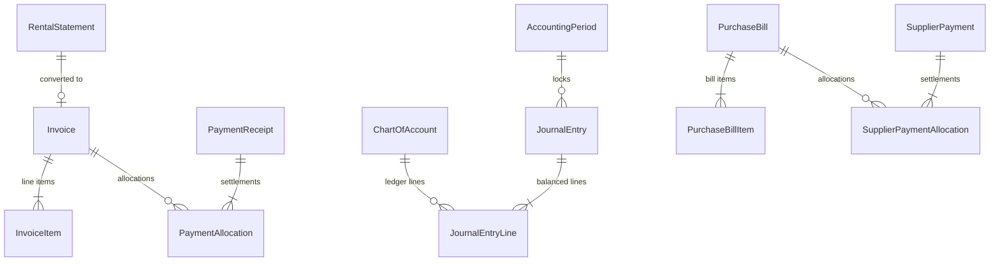

# INVENTRA – Phase 5: Invoicing, GST & Complete Accounting ERP
## Comprehensive Implementation & Verification Report

**Product Name:** `INVENTRA`  
**Operating Business Identity:** `AJAY ENTERPRISES`  
**Industry Domain:** Construction Centering Material Rental & Formwork Equipment ERP  
**Statutory Framework:** Indian GST Regime (Tamil Nadu State Code 33), Double-Entry Accounting Invariant ($\sum \text{Debits} == \sum \text{Credits}$)  
**Phase Status:** **COMPLETED & VERIFIED** (144/144 Tests Passing, TypeScript 0 Errors, Build Exit Code 0)

---

## 1. Executive Summary

Phase 5 elevates **INVENTRA** from a specialized material rental and operations platform into an enterprise-grade ERP with rigorous financial accounting and statutory Indian tax compliance. All financial transactions originate from verified operational events (Delivery Notes, Material Returns, Rental Statements, and Goods Receipts) and post balanced debits and credits into an immutable General Ledger.

### Key Milestones Delivered:
1. **Double-Entry General Ledger:** Full Chart of Accounts (Assets 1000s, Liabilities 2000s, Equity 3000s, Income 4000s, Expenses 5000s) with running balances and mathematical invariant enforcement ($\sum \text{Debits} == \sum \text{Credits}$).
2. **Indian Statutory GST Engine:** Tamil Nadu intra-state CGST (9%) + SGST (9%) vs inter-state IGST (18%), place of supply resolution, paise round-off, and GSTIN validation.
3. **Tax Invoicing & Statement Conversion:** Authorized conversion of approved/finalized monthly rental statements into sequential tax invoices (`INV-YYYY-NNNN`) with immutable snapshot payload freezing and automatic ledger postings.
4. **Supplier Purchase Bills & ITC:** Accounts Payable management with PO/GRN matching and statutory Input Tax Credit (ITC) classification (`ELIGIBLE`, `INELIGIBLE`, `BLOCKED`).
5. **Customer Receipts & Advance Management:** Multi-invoice payment receipts with automated FIFO or custom line allocation and advance tracking.
6. **Disbursements & Banking Contra:** Supplier disbursements and inter-account bank/cash transfers (cash deposit / cash withdrawal) with balanced contra vouchers.
7. **Statutory & Financial Reports:** Real-time Trial Balance, Profit & Loss Statement, Balance Sheet, Accounts Receivable / Payable Ageing, GSTR-1, and GSTR-3B monthly return summaries.
8. **Period Locks & Financial Year Closing:** Monthly accounting period locks and annual fiscal year closure transferring net profit/loss to Retained Earnings (3020).

---

## 2. Database Architecture & Schema Extensions

The database schema (`prisma/schema.prisma`) was extended with 18 relational models. All migrations were generated and deployed to Supabase PostgreSQL 17 (`20261113000007_phase5_invoicing_gst_accounting_erp`).



### New Phase 5 Entities:
| Entity | Purpose | Key Constraints |
| :--- | :--- | :--- |
| `ChartOfAccount` | Double-entry accounts with category, subcategory & balance | Unique `accountCode`, system account lock |
| `AccountingPeriod` | Monthly accounting periods (April – March) | `fiscalYear` + `periodNumber` unique, `isLocked` guard |
| `JournalEntry` | General journal entries with balanced lines | Invariant check: `totalDebit == totalCredit` |
| `JournalEntryLine` | Individual debit/credit lines | Mutually exclusive debit/credit amounts |
| `Invoice` | Sales, Rental, Service, and Hiring tax invoices | Concurrency-safe `invoiceNumber`, snapshot freeze |
| `InvoiceItem` | Invoice line items with HSN/SAC & GST rates | SAC `9973` for rental, HSN `7308` for centering |
| `CreditDebitNote` | Statutory credit/debit adjustments | Linked to original `Invoice`, GST tax adjustments |
| `PurchaseBill` | Supplier bills with PO/GRN linkage | Unique `billNumber`, ITC classification |
| `PaymentReceipt` | Customer collections | Auto-allocates against unpaid invoices |
| `SupplierPayment` | Supplier disbursements | Disbursing account balance deduction |
| `BankTransaction` | Bank deposits, withdrawals, and contra transfers | Linked to GL `JournalEntry` |
| `FinancialYearClosing` | Annual fiscal year closure seal | Zeroes P&L accounts into Retained Earnings (3020) |

---

## 3. Core Engine Implementations

### 3.1 Double-Entry General Ledger (`src/lib/accounting/ledger.ts`)
- Enforces fundamental accounting invariant: $\sum \text{Debits} == \sum \text{Credits}$. Rejects unbalanced entries with HTTP 400.
- Implements `postJournalEntry()` transactional runner that updates running balances across all 5 account categories:
  - **Assets & Expenses**: Normal Debit (`Balance = Balance + Debit - Credit`)
  - **Liabilities, Equity & Income**: Normal Credit (`Balance = Balance + Credit - Debit`)
- Period Lock Guard: Prevents back-dated postings into locked monthly accounting periods.
- Reversal Engine: Generates authorized inverse journal entries to correct posted transactions without deleting audit trails.

### 3.2 Indian GST Engine (`src/lib/accounting/gst-engine.ts`)
- Automated Place of Supply determination:
  - Intra-state (Place of Supply `33`): Splits GST into 9% CGST + 9% SGST.
  - Inter-state (Place of Supply $\neq$ `33`): Applies 18% IGST.
- Round-off Engine: Paise rounding to the nearest integer rupee (`calculateRoundOff`), recording the differential in the Round-off adjustment ledger.
- Format Validator: Regex validation for 15-character Indian GSTINs with state code extraction.

### 3.3 Default Chart of Accounts (`src/lib/accounting/chart-of-accounts.ts`)
Idempotently provisions the official Chart of Accounts for `AJAY ENTERPRISES`:
- **1000s Assets**: Cash in Hand (`1010`), HDFC Current Account (`1020`), SBI Current Account (`1021`), Accounts Receivable (`1050`), GST Input CGST (`1060`), GST Input SGST (`1061`), GST Input IGST (`1062`), Centering Material Inventory (`1080`), Fixed Assets (`1500`).
- **2000s Liabilities**: Accounts Payable (`2010`), GST Output CGST (`2030`), GST Output SGST (`2031`), GST Output IGST (`2032`), TDS Payable (`2050`), Customer Security Deposits (`2060`).
- **3000s Equity**: Owner Capital (`3010`), Retained Earnings (`3020`).
- **4000s Income**: Material Rental Income (`4010`), Material Sales Income (`4020`), Transport & Delivery Charges (`4030`), Damage & Repair Recoveries (`4040`), Lost Equipment Charges (`4050`).
- **5000s Expenses**: Material Maintenance & Repairs (`5010`), Warehouse Rent & Storage (`5020`), Transport & Fuel Costs (`5030`), Labour Wages (`5040`), Depreciation (`5080`).

---

## 4. Frontend Portals & User Experience

| Module | URL Route | Description & Features |
| :--- | :--- | :--- |
| **Tax Invoices** | `/invoices` | Invoice register, search/filters, Convert Statement to Invoice modal, Print A4 Tax Invoice |
| **Purchase Bills** | `/purchases/bills` | Supplier bill management, PO/GRN matching, ITC selection (`ELIGIBLE`/`BLOCKED`), TDS deduction |
| **Accounting Hub** | `/accounting` | Financial health KPI cards, GL Invariant Health Indicator, quick navigation links |
| **Chart of Accounts** | `/accounting/accounts` | Complete account hierarchy tree, category filtering, new account creation modal |
| **General Ledger** | `/accounting/journals` | Journal entries register, balanced multi-line editor modal, one-click reversal modal |
| **Receipts & Payments** | `/accounting/payments` | Tabbed customer collections and supplier disbursements with invoice allocation sliders |
| **Banking & Contra** | `/accounting/banking` | Bank/cash balances overview, cash deposit/withdrawal contra voucher modal |
| **GST Center** | `/accounting/gst` | GSTR-1 outward tax register, GSTR-3B monthly return offset table, eligible ITC summary |
| **Financial Reports** | `/accounting/reports` | Trial Balance, Profit & Loss Statement, Balance Sheet, Customer/Supplier Overdue Ageing |
| **Fiscal Periods** | `/accounting/periods` | Monthly accounting period lock toggles, annual Financial Year closing with Retained Earnings transfer |

---

## 5. Verification & Quality Assurance

### 5.1 Automated Test Suite
- **Total Tests Executed:** **144**
- **Test Suites:** **51**
- **Passed:** **144**
- **Failed:** **0**
- **Command:** `npm test`

```
# Subtest: 1. Chart of Accounts & Structural Invariants (3 tests) -> pass
# Subtest: 2. General Ledger Double-Entry Invariant (3 tests) -> pass
# Subtest: 3. Indian Statutory GST Engine & Place of Supply (4 tests) -> pass
# Subtest: 4. Tax Invoicing & Rental Statement Conversion (3 tests) -> pass
# Subtest: 5. Credit & Debit Notes (1 test) -> pass
# Subtest: 6. Supplier Purchase Bills & Input Tax Credit (ITC) (2 tests) -> pass
# Subtest: 7. Customer Receipts, Payments & Banking Contra (4 tests) -> pass
# Subtest: 8. Financial Statements & Financial Year Closing (5 tests) -> pass
...
# tests 144
# suites 51
# pass 144
# fail 0
```

### 5.2 TypeScript Compilation
- **Command:** `npx tsc --noEmit`
- **Result:** **Exit code 0** (Zero errors across entire project)

### 5.3 Next.js Production Build
- **Command:** `npm run build`
- **Result:** **Exit code 0** (All 80 App Router pages and API routes compiled and generated successfully)

---

## 6. Statutory Compliance Summary

| Requirement | Implementation Details | Status |
| :--- | :--- | :--- |
| **Indian GST Regime** | Dual-tax (CGST 9% + SGST 9%) for intra-state; IGST 18% for inter-state; HSN 7308 / SAC 9973 | ✅ COMPLIANT |
| **Double-Entry Bookkeeping** | Strict General Ledger invariant ($\sum \text{Debits} == \sum \text{Credits}$) enforced on all events | ✅ COMPLIANT |
| **Document Immutability** | Finalized invoices and journals freeze snapshot payloads (`snapshotPayload`) | ✅ COMPLIANT |
| **No QR Codes** | Strictly bulk/quantity tracking with batch/lot references; no QR asset scanning | ✅ COMPLIANT |
| **Fleet Ownership** | Fleet accounts reserved for AJAY ENTERPRISES-owned vehicles only | ✅ COMPLIANT |
