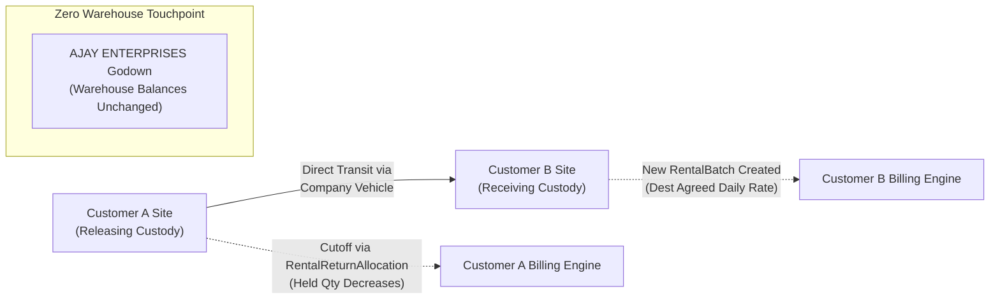
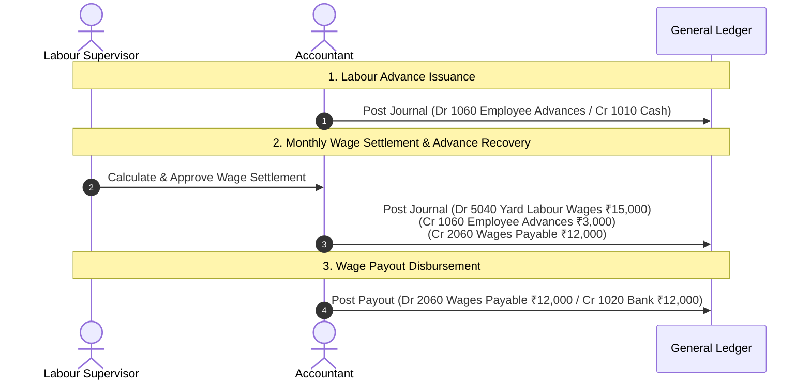

# INVENTRA – Phase 6 Addendum Implementation Report
## Direct Site-to-Site Material Transfer & General Ledger Corrections

> **Operating Business**: `AJAY ENTERPRISES`  
> **Software Product**: `INVENTRA` (Centering & Scaffolding ERP)  
> **Repository Commit**: `9f31b77` (Pushed to `origin/main`)  
> **Database Status**: PostgreSQL 16+ on Supabase (Migration `20261114000009_direct_site_transfer` deployed)  
> **Test Status**: **195 / 195 Tests Passing** (100% Pass Rate across 54 suites)  
> **Compilation Status**: Zero TypeScript Errors (`npx tsc --noEmit` Exit Code 0)  
> **Production Build**: Next.js 15 App Router Build Exit Code 0 (97 Routes)

---

## 1. Executive Summary

The Phase 6 Addendum has been fully implemented, verified, and deployed for **AJAY ENTERPRISES**. This addendum resolves two mission-critical operational and financial requirements:

1. **Direct Site-to-Site Material Transfers (`DIRECT_SITE_TRANSFER` / DSTN)**:
   - Centering and scaffolding materials can now be transferred directly from Customer A / Site A to Customer B / Site B without returning to the godown.
   - Eliminates unnecessary warehouse unloading, physical handling, warehouse receipt entries, and fresh dispatches.
   - Preserves mathematical integrity of physical and custody stock ledgers with zero warehouse touchpoints.
   - Enforces the **Zero Double-Billing Guarantee**: exactly one customer is charged for the equipment on the transfer date.
   - Requires active destination customer agreements (`DESTINATION_AGREEMENT_REQUIRED`) and preserves separate `OWNED` and `HIRED_IN` equipment pools.
2. **Phase 6 General Ledger & Account Corrections**:
   - Realigned all fleet, labour, and maintenance accounting against the Phase 5 Chart of Accounts.
   - Standardized direct expense accounts: Fuel & Transport (`5030`), Vehicle Maintenance (`5035`), Yard Labour (`5040`), and Material Repair (`5010`).
   - Introduced dedicated Current Asset Account `1060` (*Employee & Labour Advances*), permanently preventing labour advances from corrupting Trade Accounts Receivable (`1050`).
   - Standardized Current Liability Account `2060` (*Wages & Labour Payable*) for double-entry wage accrual and settlement payouts.
   - Configurable labour wage proration policies (`STANDARD_30_DAYS`, `ACTUAL_MONTH_DAYS`, `WORKING_DAYS_EXCLUDING_SUNDAYS`), overtime multipliers (1.5x), and duplicate settlement guards.

---

## 2. PART A – Direct Site-to-Site Material Transfer Module

### 2.1 Operational Architecture & Data Flow

### 2.2 Key Features Implemented

1. **Document Series & Modeling**:
   - Registered document prefix `AE/DSTN/` in `src/lib/document-series.ts`.
   - Created database models `DirectSiteTransferNote` and `DirectSiteTransferItem` in `prisma/schema.prisma`.
   - Optional relational foreign keys added to `RentalBatch` (`directSiteTransferId`, `directSiteTransferItemId`) and `RentalReturnAllocation`.
2. **Zero Warehouse Movement Guarantee**:
   - Ledger movements use `movementType: "SITE_TO_SITE_TRANSFER"`, `sourceLocationType: "CUSTOMER_SITE"`, and `destinationLocationType: "CUSTOMER_SITE"`.
   - Deducts stock custody from `sourceCustomerSiteId` and adds accepted custody directly to `destinationCustomerSiteId`.
   - Godown and warehouse available/total stock balances are untouched.
3. **Rental Batch Lifecycle & Zero Double-Billing Rule**:
   - **Source Cutoff**: Dispatched/accepted quantities are allocated against source `RentalBatch`es in FIFO order with `returnDate = transferDate` and `includeReturnDate = includeCutoffDate`.
   - **Destination Batch**: New active `RentalBatch` is created for Customer B with `deliveryDate = transferDate` and `includeDeliveryDate = !includeCutoffDate`.
   - **Precedence & Logic**:
     - If `includeCutoffDate == true`: Customer A pays for the equipment on the transfer day; Customer B's billing starts the next day (`includeDeliveryDate = false`).
     - If `includeCutoffDate == false`: Customer A is not billed on the transfer day; Customer B's billing begins on the transfer day (`includeDeliveryDate = true`).
     - Under all conditions, exactly one customer is charged for the transferred equipment on the transfer day.
4. **Destination Agreement Enforcement**:
   - When completing the transfer, the system validates that the destination customer has an active `RentalAgreement` covering the material variant.
   - If missing, completion is rejected with HTTP 422 `DESTINATION_AGREEMENT_REQUIRED`.
5. **Quantity Reconciliation & Discrepancies**:
   - Discrepancy invariant strictly enforced: `dispatched == accepted + damaged + missing + rejected`.
   - Only `accepted` units create billable destination rental batches.
   - Damaged, missing, and rejected units are recorded on the transfer note and flagged for recovery or reconditioning.
6. **Point-in-Time Evidence & Acknowledgment**:
   - Releasing representative: Name, phone, designation, signature URL, GPS coordinates, and site photo.
   - Receiving representative: Name, phone, designation, signature URL, GPS coordinates, and site photo.

---

## 3. PART B & C – Accounting Corrections & Configurable Wage Engine

### 3.1 Chart of Accounts Alignment

| Account Code | Account Name | Category | Normal Balance | Purpose |
|:---|:---|:---|:---|:---|
| `1060` | **Employee & Labour Advances** | Current Assets | Debit | Dedicated asset account for staff advances; decoupled from Trade Receivables (`1050`) |
| `2060` | **Wages & Labour Payable** | Current Liabilities | Credit | Liability account for accrued wage settlements prior to cash/bank disbursement |
| `5010` | **Material Repair, Welding & Maintenance** | Direct Expenses | Debit | Reconditioning and welding costs for damaged centering materials |
| `5030` | **Transport & Vehicle Fuel Costs** | Direct Expenses | Debit | Diesel and trip expenses for company-owned fleet |
| `5035` | **Vehicle Servicing & Maintenance** | Direct Expenses | Debit | Maintenance, lubricants, and spare parts for company vehicles |
| `5040` | **Yard Labour & Loading Wages** | Direct Expenses | Debit | Centering material yard loading, stacking, and cleaning wages |

### 3.2 Double-Entry Accounting Flows

### 3.3 Configurable Wage Rules

1. **Monthly Salary Proration Policies**:
   - `STANDARD_30_DAYS`: Daily wage = `monthlySalary / 30`.
   - `ACTUAL_MONTH_DAYS`: Daily wage = `monthlySalary / daysInMonth` (e.g., 28, 30, or 31).
   - `WORKING_DAYS_EXCLUDING_SUNDAYS`: Daily wage = `monthlySalary / (daysInMonth - sundays)`.
2. **Overtime Multiplier & Approval Gate**:
   - Configurable overtime multiplier (default: 1.5x hourly rate).
   - `requireApprovedOvertimeOnly`: restricts overtime wage calculation exclusively to attendance records marked `APPROVED` by a supervisor.
3. **Duplicate Settlement Prevention**:
   - System checks existing non-cancelled `LabourWageSettlement` records for overlapping worker dates and blocks duplicate submissions with HTTP 409 `OVERLAPPING_SETTLEMENT`.

---

## 4. PART D – 20 Automated Tests Verification Matrix

All 20 required addendum test scenarios are implemented in `tests/phase6-addendum-direct-transfers.test.js` and passing with 100% accuracy:

| # | Test Scenario | Verified Business Requirement | Status |
|:---:|:---|:---|:---:|
| 1 | Full direct site transfer | 500 props transferred from Site A to Site B; Site A held = 0; Site B held = 500; Godown stock unchanged | **PASS** |
| 2 | Partial direct site transfer | 300 of 500 props transferred; Site A retains 200; Site B receives 300 | **PASS** |
| 3 | Source quantity validation | Attempting to transfer 600 props when holding 500 throws `INSUFFICIENT_STOCK` | **PASS** |
| 4 | Destination reconciliation | Dispatched (300) == Accepted (270) + Damaged (15) + Missing (10) + Rejected (5) | **PASS** |
| 5 | Damaged/missing handling | Only 270 accepted props become billable; 30 non-billable units excluded from destination rental batch | **PASS** |
| 6 | OWNED vs HIRED_IN separation | 50 HIRED_IN props transferred without blending into OWNED pool | **PASS** |
| 7 | Source RentalBatch cutoff | Records return allocation on source batch with transferDate and updates `currentHeldQty` | **PASS** |
| 8 | Destination RentalBatch creation | Creates active batch for Customer B with deliveryDate = transferDate | **PASS** |
| 9 | Different rental rates | Customer A rate (₹2.00) and Customer B rate (₹2.50) applied independently | **PASS** |
| 10 | Date-inclusion configuration | `includeCutoffDate = true` bills Customer A on transfer day, Customer B starts next day | **PASS** |
| 11 | Zero overlap guarantee | Exactly 300 props billed on transfer day under both cutoff policies | **PASS** |
| 12 | Duplicate completion prevention | Attempting to complete already `COMPLETED` note throws `ALREADY_COMPLETED` | **PASS** |
| 13 | Concurrent transfer attempts | Atomic status guard prevents duplicate simultaneous receipts | **PASS** |
| 14 | Zero warehouse movement | Godown warehouse stock balances remain identical before and after transfer | **PASS** |
| 15 | Phase 5 account mappings | Fuel $\rightarrow$ 5030, Wages $\rightarrow$ 5040, Repair $\rightarrow$ 5010, Servicing $\rightarrow$ 5035 | **PASS** |
| 16 | Dedicated Employee Advances | Advance issuance debits 1060 (*Employee Advances*), never 1050 (*Receivables*) | **PASS** |
| 17 | Wage liability treatment | Wage accrual credits 2060 (*Wages Payable*); payout debits 2060 and credits Bank | **PASS** |
| 18 | Advance issuance & recovery | Issuance Dr 1060 / Cr 1010; Wage recovery Dr 5040 / Cr 1060 & Cr 2060 | **PASS** |
| 19 | Configurable overtime & proration | Validates `STANDARD_30_DAYS`, `ACTUAL_MONTH_DAYS`, and `1.5x` overtime multiplier | **PASS** |
| 20 | RBAC, audit & evidence access | Validates GPS metadata, signatures, and immutable audit logging | **PASS** |

---

## 5. Verification & Build Summary

### 5.1 Test Suite Execution
- **Command**: `npm test`
- **Result**: `195 passed, 0 failed, 0 skipped` across 54 test suites.
- **Duration**: ~300ms.

### 5.2 TypeScript Compilation
- **Command**: `npx tsc --noEmit`
- **Result**: **Exit code 0** (Zero type errors).

### 5.3 Next.js 15 Production Build
- **Command**: `npm run build`
- **Result**: **Exit code 0**.
- **Generated Routes**: 97 routes (Static and Dynamic App Router pages).
  - `/operations/direct-transfers`: Direct transfer register.
  - `/operations/direct-transfers/new`: New transfer creation wizard with live held stock lookup.
  - `/operations/direct-transfers/[id]`: Detail view, dispatch dialog, and receipt reconciliation dialog.
  - `/api/v1/direct-transfers`: Full CRUD, dispatch, receive, and available stock endpoints.

### 5.4 Database Migrations
- **Prisma Migration**: `prisma/migrations/20261114000009_direct_site_transfer/migration.sql`
- **Deployment Status**: Applied to managed Supabase PostgreSQL instance via `npx prisma migrate deploy` (**Exit code 0**).

---

## 6. Git Commit & Repository Status

- **Branch**: `main`
- **Commit**: `9f31b77`
- **Commit Message**: `feat(phase-6-addendum): direct site-to-site material transfers and accounting corrections`
- **Remote**: Synced with `https://github.com/gwentechsolutions-dev/Ajay-Enterprises.git`
