# INVENTRA – Project Overview & Business Specification

**Document Version**: 1.0  
**Operating Business**: AJAY ENTERPRISES  
**Software Brand**: INVENTRA  
**Classification**: Master Baseline Specification  
**Reference Asset**: Official Logo (`assets/inventra-logo.png`) & Blueprint (`docs/references/INVENTRA_Master_Software_Blueprint_v1.0.pdf`)

---

## 1. Executive Summary

**INVENTRA** is an enterprise-grade, integrated Inventory, Rental, Asset, Logistics, and Double-Entry Accounting ERP specifically engineered for **AJAY ENTERPRISES**, a construction centering material rental business based in India.

In commercial and residential construction, centering materials—including adjustable telescopic steel props, span/sapan beams, steel scaffolding sheets, column boxes, and round column shuttering—are high-value, durable capital assets leased to builders, developers, and contractors over extended, unpredictable project durations.

### 1.1 The Operational Challenge
Unlike traditional retail or wholesale distribution, centering material rental presents unique operational and accounting complexities:
- **Duration & Custody**: High-value materials leave the warehouse on Delivery Notes (DN) and remain at construction sites for weeks, months, or years without immediate sale or transfer of ownership.
- **Continuous Partial Movements**: Materials are delivered in multiple truckloads as building floors progress, and returned in partial batches via Material Return Notes (MRN) as slabs cure and formwork is dismantled.
- **Complex Rental Accrual**: Rental charges cannot be billed on simple flat trip fees. Billing is consolidated monthly, calculated from the daily quantities held at each site, subject to contractual rates, minimum rental periods, and independent delivery/return date inclusion rules.
- **Damage, Scrap, & Missing Material**: Materials are subjected to rough handling on construction sites. Returns arrive bent, dented, concrete-encrusted, or missing. The business must track physical condition upon return, route items to cleaning/straightening/welding, and recover repair or replacement costs from customer deposits or recovery invoices.
- **Multi-Site Customers**: A single builder or contractor typically runs multiple active construction projects simultaneously. Materials dispatched to Site A must not be conflated with Site B, even under the same corporate entity.
- **Statutory & Evidentiary Integrity**: In India, transport of centering material requires Goods Movement Delivery Challans and GST E-Way Bills (via FYN Gateway). Dispatches require indisputable delivery proof (GPS-tagged photographs and receiver acknowledgement) transmitted directly to authorised customer executives via WhatsApp to prevent custody disputes.
- **Financial Synchronization**: Every dispatch, return, invoice, receipt, wage payment, and asset repair must tie directly into a balanced General Ledger under double-entry accounting.

---

## 2. Business Identity vs Software Branding

- **Software Product Identity**: **INVENTRA** (Inventory, Rental, Asset Management). The software branding, login screens, application headers, favicon, and system documentation use the INVENTRA navy and industrial orange visual brand.
- **Operating Business Identity**: **AJAY ENTERPRISES**. All legal documents, statutory GST invoices, delivery challans, customer statements, agreements, WhatsApp outgoing business profiles, and bank payment instructions must prominently feature the legal trade name, address, GSTIN, PAN, and authorised signatories of **AJAY ENTERPRISES**.

> **Permanent Branding Rule**: The INVENTRA logo is the software product brand. The editable AJAY ENTERPRISES company profile represents the legal operating business. The INVENTRA logo must never be substituted for the business legal identity on tax or delivery documents.

---

## 3. High-Level System Outcomes & Success Measures

| Area | Business Outcome | Measurable Success Criteria |
| :--- | :--- | :--- |
| **Material Accountability** | Exact visibility of all owned, hired-in, and customer-held materials | Reconcile warehouse and site balances with zero unexplainable discrepancies; 100% traceability to source DNs/MRNs. |
| **Rental Billing Accuracy** | Month-end consolidated billing reflecting daily quantity intervals | 100% of rental invoices match independent daily quantity $\times$ daily rate calculations; zero duplicate billing. |
| **Delivery Proof & Non-Repudiation** | Indisputable proof of delivery at construction sites | Every completed Delivery Note has embedded GPS photographs, receiver signature, and automated WhatsApp delivery log. |
| **Accounting Integrity** | Complete financial control through double-entry accounting | General ledger balances at all times ($\sum \text{Debits} = \sum \text{Credits}$); subledgers reconcile to control accounts. |
| **Statutory Compliance** | Seamless E-Way Bill generation and GST audit readiness | Zero transport compliance holds; FYN Gateway integration with retry safety and Part-B vehicle updates. |
| **Fleet & Labour Control** | Operational visibility of company fleet and yard/site labour | Accurate tracking of company vehicle trips, maintenance, fuel logs, and supervisor-verified worker attendance/wages. |
| **Executive Intelligence** | Real-time business overview and geographical risk exposure | Interactive heatmap displaying material distribution across sites with drill-downs to financial receivables and loss exposure. |

---

## 4. Comprehensive Functional Scope Breakdown

INVENTRA delivers 27 deeply interconnected functional modules:

```mermaid
graph TD
    subgraph CoreFoundation["Platform Foundation"]
        CP[1. Company Profile & Settings]
        IAM[2. Roles & Permissions RBAC]
        AUDIT[3. Audit Logs & System History]
        DOCS[4. Document Engine & Signatures]
    end

    subgraph MasterData["Master Data & Relationships"]
        CUST[5. Customer & Multi-Site Master]
        SUPP[6. Supplier & 3rd-Party Owner Master]
        MAT[7. Item Master & Rate Versions]
        WH[8. Warehouse & Storage Locations]
    end

    subgraph OperationsLogistics["Operations & Logistics"]
        PO[9. Purchase Orders & GRN]
        DN[10. Delivery Notes & GPS Proof]
        MRN[11. Material Return Notes & Inspection]
        STN[12. Stock Transfer Notes]
        HIRE[13. Hiring-In & Hiring-Out Management]
        FLEET[14. Company Fleet Management]
        LABOUR[15. Labour Attendance & Wages]
    end

    subgraph RentalCommercial["Rental & Commercial"]
        AGR[16. Rental Agreements & Terms]
        RNT[17. Monthly Rental Billing Engine]
        INV[18. Quotations & Multi-Type Invoicing]
        TAX[19. GST & Non-GST Tax Engine]
        REP[20. Damage, Repair & Asset Recovery]
        CLOSE[21. Site Closure & Final Settlement]
    end

    subgraph FinanceReporting["Finance & Intelligence"]
        GL[22. Double-Entry Accounting Ledger]
        PAY[23. Customer & Supplier Ledgers & Payments]
        CASH[24. Cash & Bank Management]
        EWB[25. FYN Gateway E-Way Bill]
        WA[26. WhatsApp Document Delivery]
        MAP[27. Owner Dashboard & Heatmap]
    end

    CoreFoundation --> MasterData
    MasterData --> OperationsLogistics
    OperationsLogistics --> RentalCommercial
    RentalCommercial --> FinanceReporting
```



### Module Summaries:
1. **Owner Dashboard & Business Analytics**: Unified KPI control center tracking revenue, rental accruals, receivables ageing, payables, inventory exposure, and operational queues.
2. **Company Profile & Settings**: Multi-address management (registered, yard, billing), GST details, multiple bank accounts, financial year settings, and sequential document series.
3. **Customer Management**: Central customer records supporting proprietary, partnership, and corporate builders, with complete KYC attachments and tax profiles.
4. **Multi-Site Architecture**: Unlimited construction sites per customer, each with distinct GPS coordinates, delivery guidelines, site owners, and dedicated authorised contacts.
5. **Site Owners & Authorised Contacts**: Separate property owner tracking, with granular permissions for site contacts (receive goods, sign delivery, approve transfers, receive bills).
6. **Supplier & Material-Owner Management**: Vendors, repair workshops, and third-party material owners from whom materials are hired-in.
7. **Inventory & Material Master**: Categorized hierarchy (props, span/sapan, scaffolding sheets, column boxes, pipes, couplers) with dimension variants and rate histories.
8. **Warehouse & Stock Management**: Multi-yard locations, storage bins, opening balances, physical stock counts, and variance approvals.
9. **Purchase Orders & Goods Receipt Notes (GRN)**: Procurement workflow with receiving inspection, shortage/damage logging, and supplier invoice 3-way matching.
10. **Delivery Notes (DN) with GPS Proof**: Dispatch creation, vehicle assignment, mobile driver portal, site photo capture with GPS coordinates, and receiver e-signatures.
11. **Material Return Notes (MRN) & Inspection**: Multi-point return inspection classifying material as Good, Minor Repair, Major Repair, Scrap, or Missing.
12. **Stock Transfer Notes (STN)**: Transfers between company yards or authorised direct transfers between customer construction sites.
13. **Hiring-In & Hiring-Out Management**: Complete tracking of third-party rented material, ensuring hired inventory is never conflated with owned assets.
14. **Consolidated Monthly Rental Billing**: Daily quantity interval calculation engine supporting independent delivery/return date inclusion and multi-site consolidation.
15. **Commercial Invoicing**: Quotations, proforma invoices, monthly rental bills, sales invoices, hiring invoices, and service/transport charges.
16. **GST & Non-GST Billing Engine**: Comprehensive Rule 46 tax invoices, bills of supply, CGST/SGST/IGST calculations, and unregistered customer handling.
17. **Double-Entry General Ledger**: Chart of accounts, automated journal entries for all operational events, cash/bank books, and financial trial balance.
18. **Customer & Supplier Ledgers**: Real-time statement of accounts, FIFO or manual payment allocation, advance deposits, and credit/debit notes.
19. **Cash, Bank, Income & Expense Management**: Multiple bank accounts, petty cash management, expense categorization, and bank statement reconciliations.
20. **Labour Attendance & Wage Management**: Yard and site workers, biometric/supervisor attendance, daily/monthly wage calculation, advances, and payment sheets.
21. **Company Fleet Management**: Exclusively company-owned trucks/trailers, driver assignments, PUC/insurance/fitness renewals, and trip fuel logs.
22. **Material Damage, Repair & Maintenance**: Maintenance job cards, internal/external repair costs, and damage recovery billing to customers.
23. **Site Closure & Final Settlement**: Strict settlement protocol verifying material reconciliation, security deposit adjustment, and final clearance certificates.
24. **FYN Gateway E-Way Bill Integration**: Automated EWB generation via FYN API, Part-B transport vehicle updates, cancellations, and statutory validity tracking.
25. **WhatsApp Document Delivery**: Automated distribution of finalized DNs, EWBs, statements, and payment receipts to authorised site contacts via WhatsApp API.
26. **Electronic Signatures & Company Seal**: Permission-controlled digital signature/stamp overlays and CCA-compliant eSign audit trails.
27. **Interactive Geographical Heatmap**: Map view clustering active construction sites and yards, toggling between material quantities, replacement values, and rental revenue.

---

## 5. Portal & User Persona Matrix

INVENTRA provides five purpose-built responsive portals operating against a single unified backend:

```
┌────────────────────────────────────────────────────────────────────────┐
│                        INVENTRA CORE PLATFORM                          │
├─────────────────┬──────────────────┬─────────────────┬─────────────────┤
│  Owner / Admin  │ Office / Finance │ Warehouse Staff │ Field Logistics │
│     Portal      │      Portal      │     Portal      │   Mobile PWA    │
│ (Desktop/Table) │ (Desktop/Table)  │ (Tablet/Desktop)│ (Mobile Phone)  │
└─────────────────┴──────────────────┴─────────────────┴─────────────────┘
```

1. **Owner / Super Admin Portal**: Complete business visibility, financial oversight, profit & loss, high-value approvals, audit trail inspection, and system settings.
2. **Office & Accountant Portal**: Customer/site master, quotation builder, rental billing engine, invoice generation, voucher posting, payment allocation, and GST filings.
3. **Warehouse Portal**: PO receipt, GRN creation, dispatch staging/picking, return inspection, repair routing, and physical count reconciliations.
4. **Delivery Personnel Mobile Portal**: Offline-capable PWA for drivers/dispatchers. Displays assigned trips, site navigation links, loading confirmation, GPS camera photo capture, and customer receiver sign-off.
5. **Labour Supervisor Mobile Portal**: Fast attendance logging for yard workers and site loaders, overtime tracking, site allocations, and advance requests.

---

## 6. Permanent System Exclusions

To avoid scope creep and maintain absolute domain focus, the following are permanently excluded from INVENTRA:
- ❌ **No QR Code Material Tracking**: Centering materials (props, sapan, sheets) operate in heavy cement, mud, and abrasive construction environments where adhesive or laser QR stickers deteriorate rapidly. Tracking is maintained via strict bulk quantity movements, lot references, and physical return counts.
- ❌ **No Hired / Market Vehicle Fleet Management**: All vehicles operated by AJAY ENTERPRISES are company-owned. Third-party hired-truck logistics management is strictly excluded.
- ❌ **No Live IoT GPS Tracking on Materials**: Centering materials do not carry active GPS hardware. GPS data is captured strictly as point-in-time evidentiary metadata during Delivery Note and Return Note photo capture at customer sites.
- ❌ **No Automatic Legal Presumptions**: The system provides compliant data structures and statutory checklists but leaves taxability rules, rate classifications, and legal determinations to accountant-approved configuration.

---

## 7. Managed Platform & Technology Infrastructure

INVENTRA is powered by **Next.js 15+ App Router** coupled with **Supabase** as the unified managed backend platform:
- **Database**: Supabase Managed PostgreSQL 16+ with the **PostGIS** geospatial extension for GPS location indexing and site heatmaps.
- **Connection Strategy**: High-concurrency runtime connections route through the Supavisor connection pooler (`DATABASE_URL`, port 6543, transaction mode / pgbouncer=true). Schema migrations and Prisma CLI operations utilize the direct connection (`DIRECT_URL`, port 5432).
- **Authentication**: Managed via **Supabase Auth** with session cookie synchronization via `@supabase/ssr` and Next.js middleware. Eliminates secondary password databases while preserving INVENTRA's custom 9-role RBAC matrix.
- **Private File Storage**: Managed via **Supabase Storage** (`inventra-private-documents` private bucket). Private access only with MIME whitelisting, 10MB limits, SHA-256 checksums, and short-lived pre-signed download URLs.
- **Security & Authorization**: Row Level Security (RLS) enabled across all database tables and storage objects, backed by server-side `requirePermission()` guards and database triggers enforcing append-only immutability on audit logs.

